# SnapSharp: Screenshots, Local AI, and Image Tools

[简体中文](README.md) | **English**

Repositories: [GitHub](https://github.com/leelongjiang/SnapSharp) | [Gitee](https://gitee.com/lilongjiang/SnapSharp) · [Download releases](https://github.com/leelongjiang/SnapSharp/releases) · [Full user guide](docs/UserGuide.en.md)

Writing a tutorial means marking the important parts of a screenshot. Reading a document may call for extracting and translating its text. Preparing images may involve removing a background, stitching a long page, or recording a short demonstration. SnapSharp brings these tasks together in one Windows tool.

Alongside screenshots, annotations, and desktop pins, it uses local models for OCR, table recognition, formula recognition, background removal, and translation. Continue processing a fresh capture, or import an image you have copied from another application.

The interface supports English and Simplified Chinese. Open Settings → General → Interface language, choose Follow system, 简体中文 or English, then save. See the [localization guide](docs/本地化.md) to add another language.

  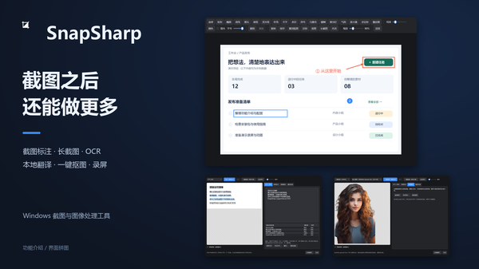

| What you want to do | What SnapSharp offers |
|---|---|
| Explain an interface or illustrate a tutorial | Area capture, arrows, text, numbers, pixelation, blur, and other annotations |
| Turn an image into editable content | Chinese/English OCR, tables to CSV / XLSX, formulas to LaTeX |
| Read text in another language | Translation after OCR, with a local Qwen model or optional online services |
| Isolate an image subject | Background removal, transparency preview, and PNG / WebP output |
| Keep references close while working | Image, text, and color pins with zoom, opacity, and groups |
| Preserve continuous content or demonstrate a task | Scrolling screenshots, MP4 recording, and GIF output |

[Annotations](#selection) · [Local AI](#recognition) · [Desktop pins](#pins) · [Scrolling capture](#scrolling) · [Recording](#recording) · [Getting started](#start)

Screenshots show the Simplified Chinese interface; descriptions and captions below are in English.

## 1. Capture an image and explain the important parts

Press `Ctrl+Shift+A` to select an area and annotate it directly. Combine rectangles, ellipses, arrows, text, numbers, and highlights. Use pixelation or blur when you need to obscure content.

Annotations can be selected, moved, resized, rotated, reordered, undone, and redone. Capture selections can also be elliptical, freehand, or polygonal to suit different subjects.

  

<em>The capture toolbar provides annotation tools and actions for processing the selected area.</em>

  

<em>Sample illustration: point to an entry, frame a task, and add a short explanation.</em>

  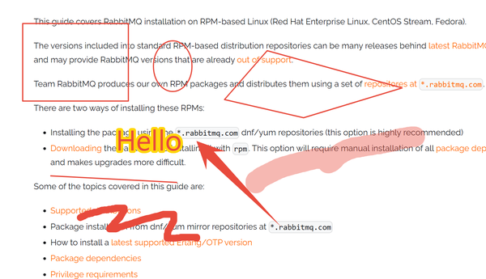

<em>Arrows, highlights, and text explain the important parts of a RabbitMQ article capture.</em>

Copy, save, pin the result, or continue with recognition and background removal. Before selecting an area, the magnifier also shows a pixel grid and color values; press `C` to copy the current color.

## 2. Local AI: turn images into content you can use

Copy an image, then open clipboard image recognition from the tray to choose OCR, table recognition, formula recognition, or background removal. Capture selections, pins, and the editor offer related entry points too.

Download the relevant models before first use. Once configured, OCR, tables, formulas, background removal, and local translation run on your computer. Basic screenshots and annotations are ready to use without these models.

  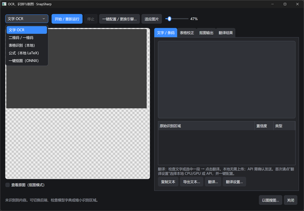

<em>The recognition window provides a mode selector for text, barcodes, tables, formulas, and background removal.</em>

### Chinese and English OCR: extract text from images

Recognize paragraphs in screenshots, instructions, or reference material, then copy or export the text. Recognition boxes, editable text, and the original recognition rows can locate one another so you can compare the result with the image.

  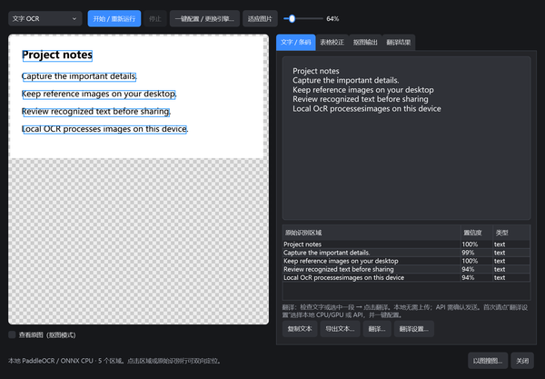

<em>English sample processed by local PaddleOCR. The result remains editable and can be copied or exported.</em>

  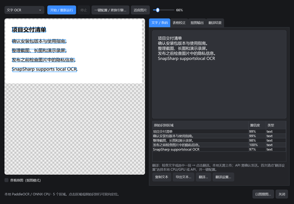

<em>Chinese sample: local PaddleOCR extracts a checklist, with text and confidence values available for review.</em>

  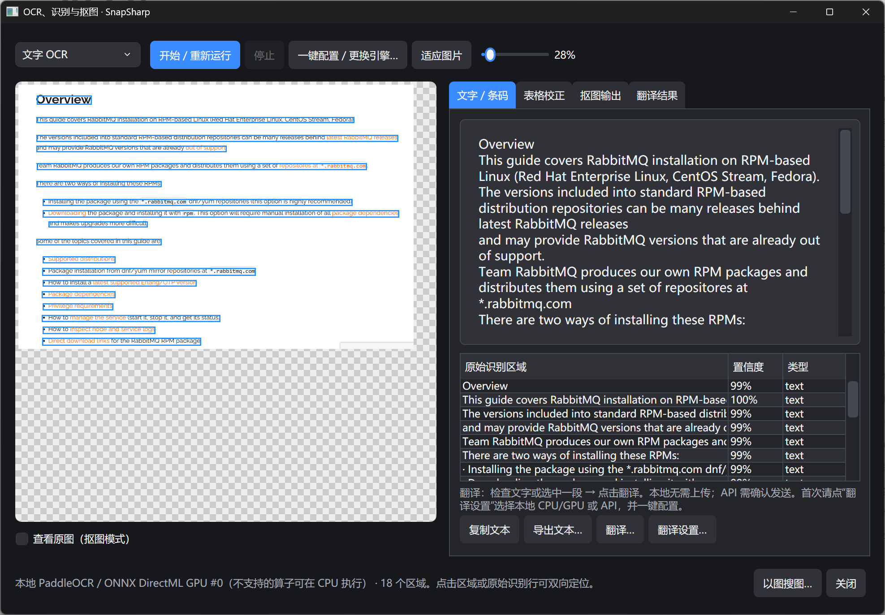

<em>A longer English reference example, with text boxes on the left and recognized text and original rows on the right.</em>

SnapSharp provides PaddleOCR, Windows OCR, and Tesseract as local engines. PaddleOCR and background removal support CPU or DirectML GPU selection. Review recognized text, especially spaces, punctuation, and complex layouts.

### Local translation: keep reading after OCR

Click Translate after OCR to process all the text or a selected passage. Local translation uses Qwen with llama.cpp on CPU or Vulkan GPU. Once downloaded, the model processes text without sending it to an external service.

  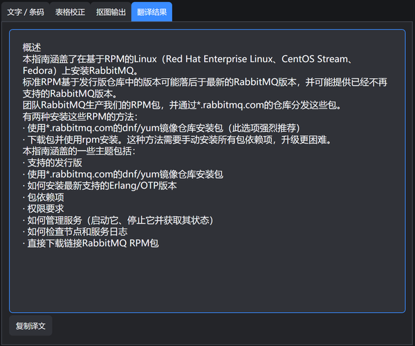

<em>A detail from the existing local translation screenshot. <a href="Screenshot/6.png">View the full source image and translation window</a>.</em>

  

<em>The full existing translation example shows the RabbitMQ source, OCR text, and local Chinese translation together.</em>

Optional online providers include MyMemory, the Google web adapter, and LibreTranslate. Online sending requires explicit enablement and confirmation. Check both the OCR source and the translation produced by a small model.

### Table recognition: move from screenshots to CSV or Excel

Local SLANet recognizes table structure and matches OCR text to cells. Review and edit row, column, row span, column span, and text before exporting to CSV or XLSX.

  

<em>The sample is recognized as 4 rows × 3 columns. Review the cell data on the right before exporting.</em>

### Formula recognition: convert a formula image to LaTeX

Select an individual formula and choose local LaTeX recognition to obtain editable, copyable LaTeX. Export it as a `.tex` file to continue writing or typesetting.

  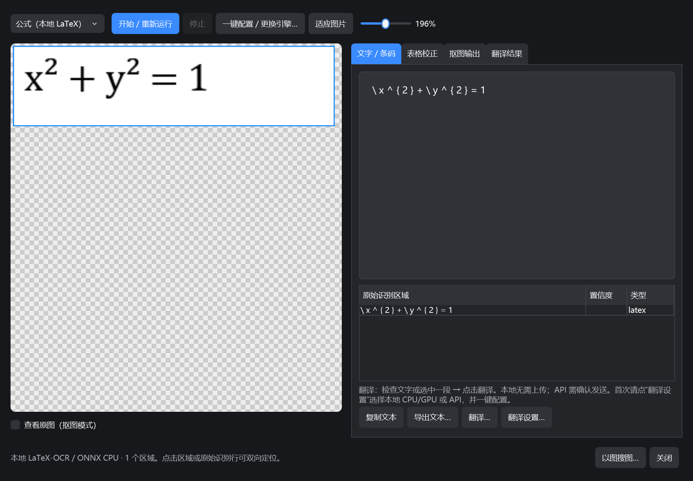

<em>A circle-equation sample with the original image on the left and actual model output on the right. Review the output and adjust typesetting as needed.</em>

### Background removal: keep the subject

Switch to ONNX background removal, select a configured model, and run it. The checkerboard indicates transparency; toggle the original image to compare, then copy, save, or pin the result.

  

<em>The same portrait before and after actual BiRefNet General Lite inference on CPU, preserving its original dimensions.</em>

  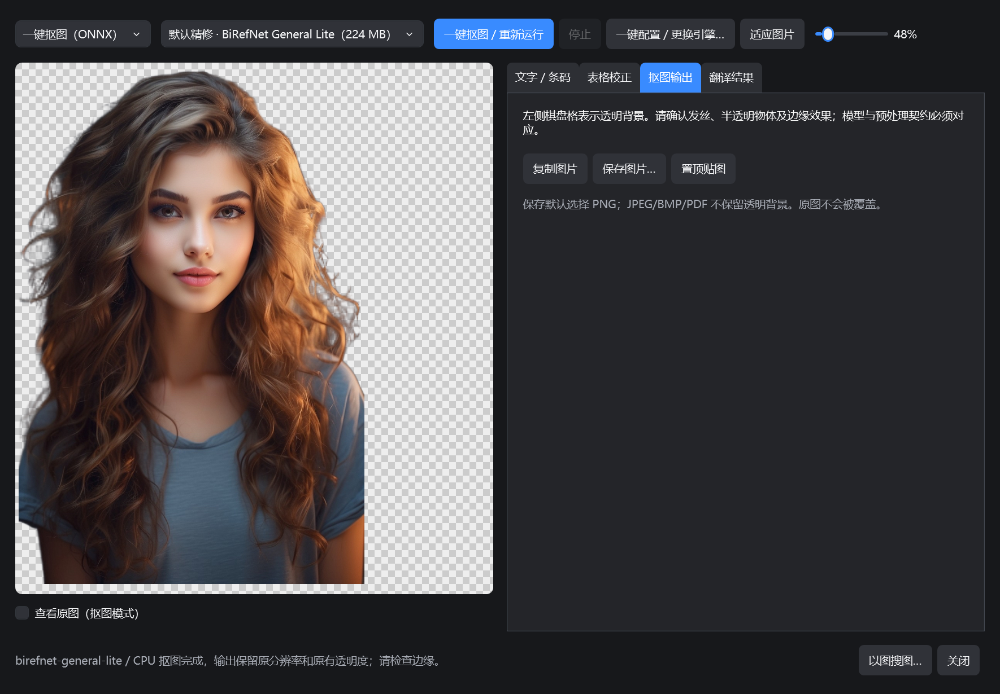

<em>Inspect edges in the result window, then copy, save, or pin the image.</em>

Choose a model to suit the task: lightweight U²-Net for a quick start, BiRefNet General Lite for everyday use, or the portrait, Matting, and HR options. Use PNG or a transparency-capable WebP mode to preserve the background transparency. Inspect hair, glass, and translucent edges; see the [user guide](docs/UserGuide.en.md#cutout) for larger-model requirements and known limitations.

SnapSharp also reads QR codes and one-dimensional barcodes, and offers session-only hover OCR. Barcode recognition does not require an AI model download.

## 3. Keep images, text, and colors on the desktop

Copy an image and press `Ctrl+Shift+V` to pin it above other windows. Text and colors can become pins too, keeping references close while coding, writing, or adjusting a design.

  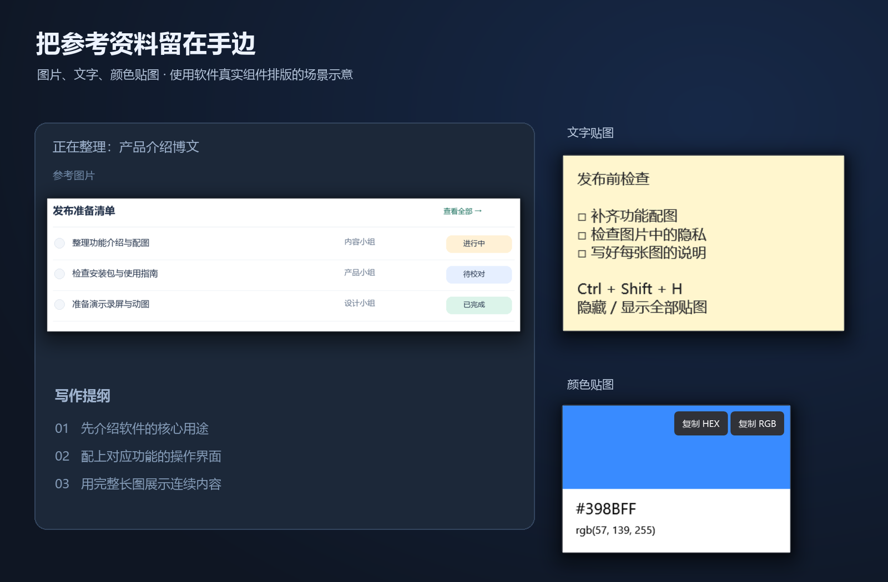

<em>Illustrative pin workspace: keep a reference image, checklist, and color values close at hand.</em>

Use the wheel to zoom, `Ctrl+wheel` to adjust opacity, and `Ctrl+Shift+H` to hide or show all pins. The context menu also provides annotation editing, rotation, groups, mouse passthrough, recognition, and background removal.

  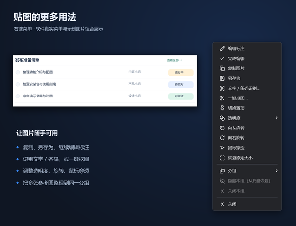

<em>The pin context menu offers editing, recognition, background removal, opacity, rotation, mouse passthrough, and groups.</em>

  

<em>Pin settings control opacity, edge snapping, and the font, size, and background of text pins.</em>

## 4. Stitch content that extends beyond one screen

Preserve long pages, lists, and continuous reference material with scrolling screenshots. Select an area, scroll slowly, then inspect seams, trim edges, and add annotations in the preview.

  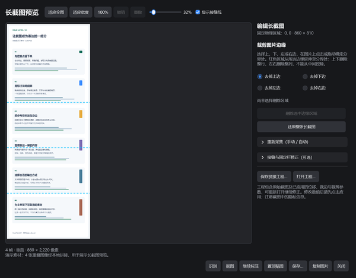

<em>Preview of overlapping sample images stitched by the application. Inspect seams and trim the result. <a href="Screenshot/Blog/03-long-image-result.png">View the full image</a>.</em>

  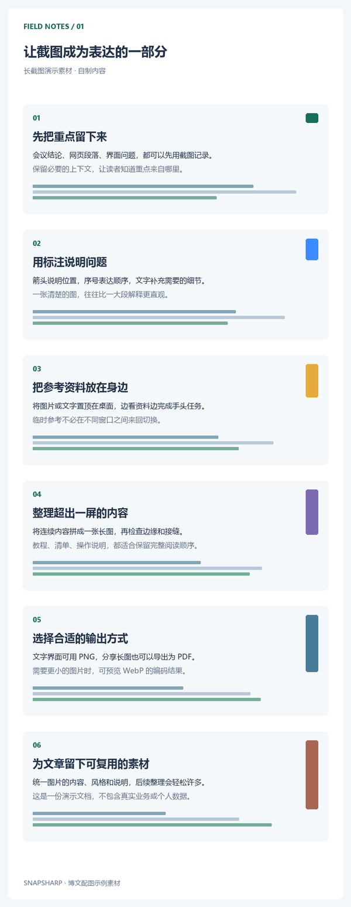

<em>The complete 860 × 2220 result, stitched by the application from four overlapping sample images.</em>

Manual mode listens to your scrolling; click `√` when finished. Automatic mode sends wheel input. Save a `.ssscroll` project to reopen the original frames and continue making adjustments later.

## 5. Record a demonstration as MP4 or GIF

Record a rectangular area within one display to show a sequence of actions. MP4 supports optional audio, while GIF suits short, silent demonstrations. Configure a countdown, cursor display, click highlights, or timed stopping.

  

<em>MP4 recording configuration. Target rates include 15, 30, and 60 fps; actual performance depends on capture and encoding.</em>

  

<em>GIF recording configuration for short, silent demonstrations; inapplicable options such as audio are disabled.</em>

  

<em>The floating toolbar brings record, pause, stop, and configuration actions together.</em>

Audio and camera capture are initially off; subsequent recordings remember their switches and device choices. System audio follows the current Windows default output unless you select a specific device. Set a separate recording folder in Settings → Output & Files; recordings receive unique filenames automatically. GIF has no audio, supports up to 15 fps, and is limited to 60 seconds. Use the recording environment setup to check required components before first use.

## 6. Choose the format and dimensions before saving

Captures, pins, the editor, and scrolling results share an output window. PNG suits text and transparency, JPEG suits photos, and WebP offers lossy and lossless modes. TIFF, BMP, and A4-paginated PDF are also available.

  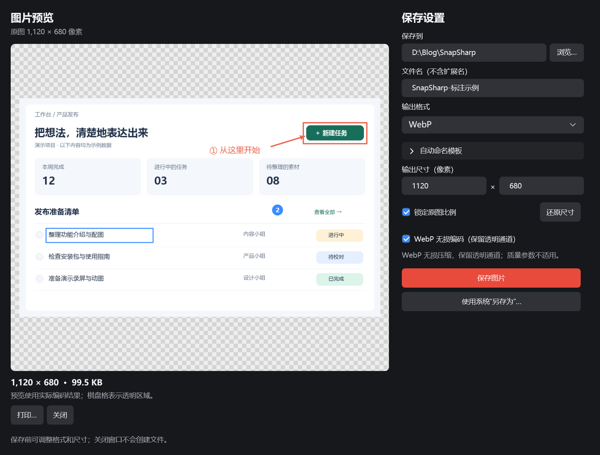

<em>The encoded preview helps you check appearance, pixel dimensions, and file size. Long images can also be <a href="Screenshot/Blog/05-export-pdf.png">exported to PDF</a>.</em>

  

<em>PDF output can paginate a long image onto A4 pages; the left preview shows the complete source image.</em>

For ongoing work, configure automatic saving, date-based folders, and filename templates. Automatic saving and screenshot history are separate switches.

  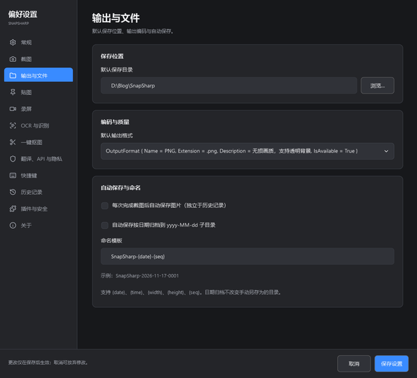

<em>Output settings provide the save directory, default format, automatic saving, date folders, and filename templates.</em>

## 7. Download and get started

Get a release package from [GitHub Releases](https://github.com/leelongjiang/SnapSharp/releases), keep the entire application directory, and run `SnapSharp.exe`. The application stays in the notification area and does not open a main window by default.

1. Press `Ctrl+Shift+A` and select an area.
2. Add arrows, text, numbers, or pixelation.
3. Copy, save, or pin the image.
4. For AI processing, open clipboard image recognition from the tray, choose a mode, and run it.

| Default shortcut | Action |
|---|---|
| `Ctrl+Shift+A` | Capture an area |
| `Ctrl+Shift+F` | Capture the full screen |
| `Ctrl+Shift+W` | Capture the current window |
| `Ctrl+Shift+V` | Create a pin from the clipboard |
| `Ctrl+Shift+H` | Hide/show all pins |

  

<em>Customize shortcuts for captures, pins, and showing or hiding pins to match your workflow.</em>

### Configure AI features for the first time

Download the relevant models from Settings, then click Save Settings. Install only the features you need; a separate Python installation is not required.

| Feature | Settings location |
|---|---|
| Recommended Chinese/English OCR | OCR and recognition → recommended ONNX OCR setup, about 14.2 MB |
| Tables and formulas | OCR and recognition → local tables and formulas |
| Background removal | Background removal → download a model and choose the default |
| Local translation | Translation, APIs, and privacy → local engine, about 1.04 GiB for the model and runtime |

  

<em>OCR and recognition settings configure engines, local models, and CPU / DirectML execution.</em>

  

<em>Translation, API, and privacy settings configure the local translation runtime and optional online services.</em>

### System requirements and local data

- Windows 10 version 2004 or later, or Windows 11; x64.
- The self-contained release needs no separate .NET Desktop Runtime. Framework-dependent builds require .NET 10 Desktop Runtime.
- Recording may require the VC++ x64 runtime and Windows media components.
- Initial model downloads require internet access. Local AI processing does not upload images or text; online translation and image search require authorization.

Settings, models, and history are stored in `%LocalAppData%\SnapSharp`. Screenshot history is not encrypted. See the full guide for model choices, data handling, and troubleshooting.

### If something does not work

If no window appears at launch, look for the tray icon. If a shortcut does not respond, check for conflicts in Settings. If an AI feature reports a missing model, complete its setup and save the settings. See [quick troubleshooting](docs/UserGuide.en.md#faq) for more.

## Documentation and license

- [English user guide](docs/UserGuide.en.md) / [中文使用指南](docs/使用指南.md): detailed operation, initial setup, and troubleshooting.
- [Configuration and dependencies](docs/配置与依赖.md): models, runtime components, and services (Chinese).
- [Build and test instructions](docs/构建与测试.md): development and verification (Chinese).
- [Documentation index](docs/README.md) · [Image notes and provenance](Screenshot/Blog/README.md).

Illustrations include sample content, actual model results, and labeled composite scenes. Review AI output against its source; results vary with the input, model, and device.

Copyright 2026 leelongjiang and SnapSharp contributors. SnapSharp is released under the [Apache License 2.0](LICENSE). Third-party component and model licenses are documented in [THIRD-PARTY-NOTICES.md](THIRD-PARTY-NOTICES.md).
