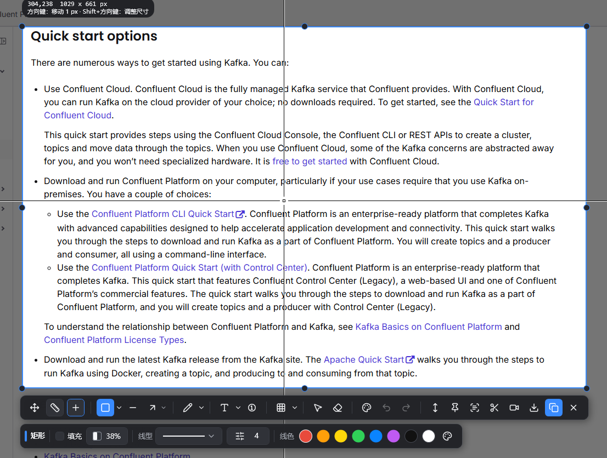
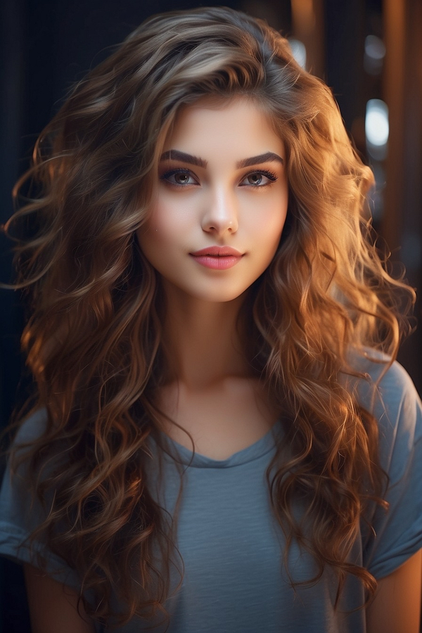
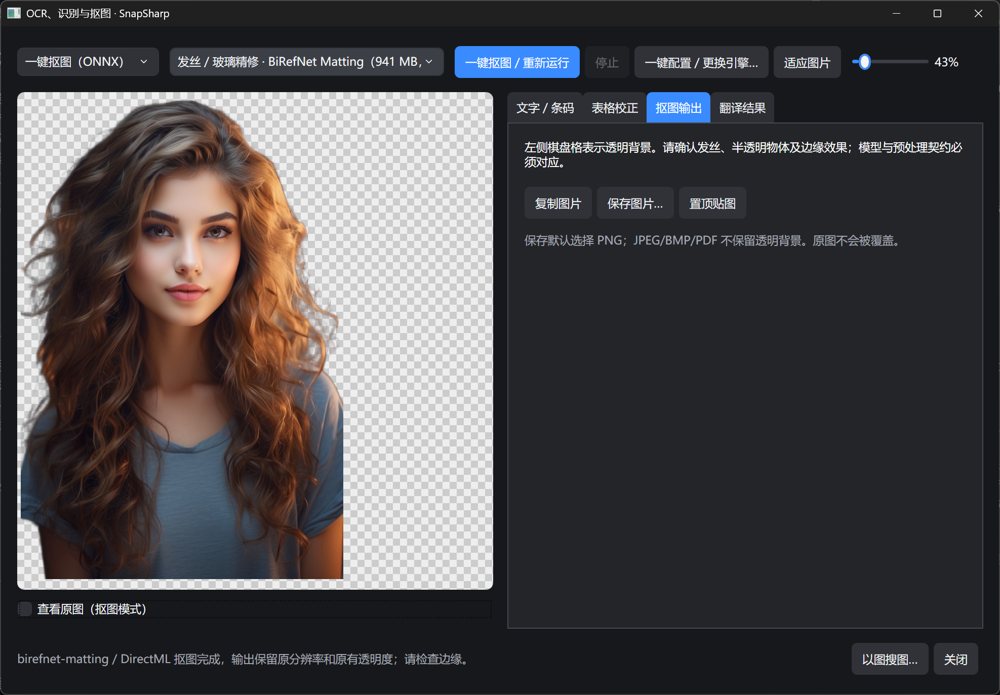
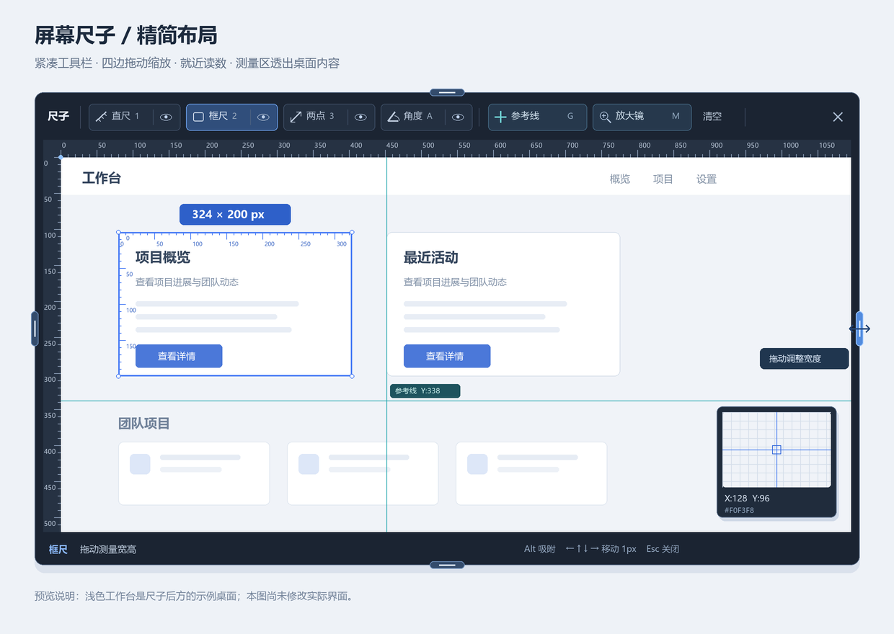

# NimCap Screenshot: Windows Screenshots, OCR, Translation, Background Removal, and Recording

[简体中文](README.md) | **English**

[GitHub](https://github.com/nimcap/nimcap-screenshot) · [Gitee](https://gitee.com/lilongjiang/SnapSharp) · [Website](https://jietu.nimcap.com/) · [Releases](https://github.com/nimcap/nimcap-screenshot/releases)

NimCap Screenshot implements region, full-screen, and active-window screenshots; element selection; annotations and sensitive-text blurring; desktop pins; scrolling capture; image OCR; identity-document field extraction; tables to CSV/XLSX; formulas to LaTeX; QR/barcode recognition; local translation; background removal; screen color picking and measurement; and MP4/GIF recording. **Local AI, offline operation, and data kept on your computer**: OCR, tables, formulas, background removal, and translation can run with local models without uploading images or text to the cloud. Once the application, required models, and runtime dependencies are prepared, these local features work without internet access, including on internal networks. This reduces the risk of sensitive material leaving your device and supports privacy-conscious personal and internal office use. Online translation and image search are optional, disabled by default, and require confirmation for each request.

Brand: **NimCap**. Software: **NimCap Screenshot**. Repository: `nimcap-screenshot`. Formerly SnapSharp; internal namespaces, plugin contracts and existing user-data directories retain compatibility.

## About NimCap Screenshot

The recognition window includes **Remove watermark** with MI-GAN (fast), LaMa (default), Moebius (detail candidate), and SLBR for region/full-image detection. All offer automatic download, verification and configuration from official or China sources, without manual model conversion. Compare the original, undo, copy, save, or pin the result. See [watermark repair and model contracts](docs/去水印与图像修复.md).

NimCap Screenshot is a Windows x64 desktop application built with C#, WPF, and .NET 10. It runs in the notification area and is operated through global shortcuts and tray menus. Use it to illustrate tutorials, report interface issues, extract reference material, work with tables and formulas, or record demonstrations.

After capture, annotate, blur sensitive text, copy, save, or pin the image. Images copied from other applications can enter the unified recognition window through **Recognize Clipboard Image…**. Basic capture, editing, pins, and measurement need no AI downloads.

The interface includes English and language/region packs for Chinese, Japanese, Korean, German, French, and others. Select a language under **Settings → General → Interface Language**, then save. Some additional translations are machine-generated drafts. UI, OCR, and translation languages are configured independently.

## Implemented features

| Feature | What it does | Output and requirements |
|---|---|---|
| Screenshots | Region, full screen, active window, delayed capture; rectangle, ellipse, freehand lasso, polygon selections; snapping to controls and browser accessibility elements | Copy, save, pin, or recognize; multiple monitors and mixed DPI; element capture covers visible content |
| Annotations and editing | Shapes, arrows, text, numbered steps, highlighter, pixelation, blur; move, resize, rotate, reorder, undo/redo, annotation templates | Composite image output; image rotation, flipping, and canvas expansion |
| Sensitive-text blurring | Local OCR and rules locate phone numbers, identity/card numbers, email, license plates, name fields, and addresses | Available in capture and pin editing; requires OCR; optional local Qwen assistance for names/addresses; review the result |
| Desktop pins | Keep images, text, and colors on top; zoom, opacity, rotation, click-through, groups, hide/restore, restore the last closed pin | Keep reference material visible, then edit, recognize, or remove its background |
| Scrolling capture | Manual or automatic vertical scrolling, stitching preview, edge trimming, seam adjustment | Long images or paginated PDF; `.ssscroll` projects retain source frames and adjustments |
| Text OCR | Local PaddleOCR, Windows OCR, and Tesseract; editable results linked to source boxes | Copy or export TXT; configure models, trained data, or a Windows language pack for the selected engine |
| Document fields | Chinese ID front/back/combined images, driving and vehicle licenses, household registers, passports, bank cards, business licenses | Edit, copy, export TXT; reuses local OCR without a separate document model; current-page rule extraction, no authenticity verification |
| Table recognition | Local SLANet structure plus OCR text, editable rows, columns, and merged cells | CSV/XLSX; requires table and OCR setup; select one table |
| Formula recognition | Local LaTeX-OCR converts one formula image into editable text | Copy LaTeX or export `.tex`; requires matching models; review complex formulas |
| QR/barcodes | Decode QR codes and one-dimensional barcodes in images | Text results; no AI model download |
| Translation and hover OCR | Translate OCR text or a selected passage; recognize text near a stationary pointer | Local Qwen3.5 + llama.cpp on CPU/Vulkan; optional MyMemory, Google web adapter, LibreTranslate; hover OCR is enabled per session |
| Background removal | U²-Net and BiRefNet presets, transparency preview, original comparison, temporary model selection | Original dimensions and alpha; copy, pin, PNG/WebP; download a model; presets depend on the selected device |
| Color picking and ruler | Magnified color sampling; standalone line, box, two-point distance, angle, guides, pixel measurements | Copy color values or measurement results; no AI models |
| MP4/GIF recording | Region within one monitor, pause/resume, countdown, timed stop, cursor and click highlights; optional system audio, microphone, camera for MP4 | H.264 MP4 with optional AAC; silent GIF up to 15 fps and 60 seconds; environment setup available |
| Image output and history | PNG, JPEG, WebP, TIFF, BMP, A4-paginated PDF; resize/encoding previews, automatic saving, date folders, filename templates, history | History stores composite PNG images, without editable annotation objects; history and autosave are separate switches |
| Settings and extensions | Multilingual UI, shortcuts, themes, startup registration, data migration, model download sources and storage management, manual update checking | Optional recognition plugins; generic uploading and action chains remain future work |

See the [feature-to-code reference](docs/功能与代码对照.md) and [configuration reference](docs/配置与依赖.md) (Chinese) for implementation boundaries.

### Capture and annotate

Press `Ctrl+Shift+A`. The default element mode snaps to controls on hover; you can also drag a selection. Use `Tab` or the top selector to switch modes, then add arrows, text, numbers, or blur before copying, saving, or recognizing.

### Local recognition, translation, and background removal

Copy an image and open **Recognize Clipboard Image…** from the tray. Choose text, documents, barcodes, tables, formulas, or background removal, then run. Translation consumes OCR results or entered text. Save transparent results as PNG or transparency-capable WebP.

| Original | Background removed |
|---|---|
|  |  |

### Desktop pins

Copy an image and press `Ctrl+Shift+V` to pin it. Use the wheel to zoom and `Ctrl+wheel` for opacity. The context menu provides groups, click-through, editing, and recognition. Create text and color pins from the tray.

### Scrolling screenshots

Select a region from the tray scrolling-capture menu. Manual mode follows actual scrolling; automatic mode sends wheel input. Review seams and trim edges before exporting or saving an `.ssscroll` project.

### Screen recording

Click the video icon in a rectangular selection or open the recording toolbar from the tray. Choose MP4 or GIF, enable devices as needed, and record, pause, resume, or stop to save. Audio and camera start disabled; later recordings remember choices. Actual frame rates depend on capture and encoding performance.

### Measurement and output

The tray ruler measures lengths, boxes, distances, and angles; the capture magnifier copies colors. The save window previews dimensions and encoding settings, and can paginate long images onto A4 PDF pages.

## Download and get started

1. Download the Windows x64 package from [GitHub Releases](https://github.com/nimcap/nimcap-screenshot/releases), extract the entire directory, and run `NimCap.Screenshot.exe`.
2. Find its tray icon and press `Ctrl+Shift+A` to select an area.
3. Annotate, copy, save, or pin it. Press `Esc` to cancel.
4. Download and configure models in Settings when you need OCR, tables, formulas, background removal, or local translation.

| Default shortcut | Action |
|---|---|
| `Ctrl+Shift+A` | Region screenshot |
| `Ctrl+Shift+F` | Full-screen screenshot |
| `Ctrl+Shift+W` | Active-window screenshot |
| `Ctrl+Shift+V` | Pin from clipboard |
| `Ctrl+Shift+H` | Hide/show all pins |

Ruler and pin-restoration shortcuts are initially blank; configure them under **Settings → Shortcuts**.

## First-time setup and requirements

| Feature | Setup location |
|---|---|
| Chinese/English PaddleOCR | Settings → OCR and Recognition → recommended ONNX OCR setup; Windows OCR and Tesseract are alternatives |
| Tables/formulas | Settings → OCR and Recognition → Local Tables and Formulas; configure each separately |
| Background removal | Settings → Background Removal; choose CPU/DirectML, download a model, set the default; CPU presets are U²-Net and General Lite |
| Local translation | Settings → Translation, APIs, and Privacy; Qwen3.5 GGUF plus llama.cpp; default 4B Q4_K_M model is about 2.81 GiB, plus runtime |
| Recording | Settings → Recording → recording environment setup |

- Windows 10 version 2004 or later, or Windows 11; x64.
- Self-contained releases include .NET. Framework-dependent builds require .NET 10 Desktop Runtime. Native features such as recording may require VC++ x64 and Windows media components.
- Initial model downloads require internet access, without Python or CUDA. Local image inference uses ONNX CPU/DirectML; translation uses CPU/Vulkan.
- ONNX runs in a separate worker process. GPU initialization/inference failures or insufficient memory budget can fall back to CPU without changing saved preferences. Vulkan translation failures do not automatically switch to CPU.
- Online translation/image search require explicit enablement and per-request confirmation. History is stored locally without encryption. The default data directory is beside the application; migrate it under Settings → General → Local Data, effective after restart.

If no window appears, check the tray. Check shortcut conflicts in Settings. For missing models, complete and save the corresponding setup. See the [user guide](docs/UserGuide.en.md#faq).

## Documentation and development

- [Documentation index](docs/README.md) · [Feature-to-code reference](docs/功能与代码对照.md) (Chinese)
- [English user guide](docs/UserGuide.en.md) · [中文使用指南](docs/使用指南.md)
- [Configuration](docs/配置与依赖.md) · [Build and tests](docs/构建与测试.md) (Chinese)
- [Architecture](docs/ARCHITECTURE.md) · [Localization](docs/本地化.md) · [Inference isolation](docs/异常与推理隔离.md) (Chinese)
- [Feature specifications and roadmap](<docs/NimCap Screenshot 功能规格与路线图.md>) · [Image provenance](Screenshot/Blog/README.md)

The feature list describes current repository code. Recognition quality, complex scrolling content, large models, and hardware compatibility still require input-specific review. Planned features and candidate components are documented separately in the roadmap.

Copyright 2026 leelongjiang and NimCap Screenshot contributors. Licensed under [Apache License 2.0](LICENSE). Component and model licenses are listed in [THIRD-PARTY-NOTICES.md](THIRD-PARTY-NOTICES.md).
