# SnapSharp：截图、AI 识别与图像处理工具

**简体中文** | [English](README.en.md)

项目地址：[GitHub](https://github.com/leelongjiang/SnapSharp) | [Gitee](https://gitee.com/lilongjiang/SnapSharp) · [下载发布版](https://github.com/leelongjiang/SnapSharp/releases) · [完整使用指南](docs/使用指南.md)

写教程时，需要在截图上说明重点；阅读外文资料时，希望直接提取文字并翻译；整理图片时，又可能需要去掉背景、拼成长图或录一段操作演示。SnapSharp 把这些操作放进了一款 Windows 工具里。

它既能截图、标注和桌面贴图，也能通过本地模型完成 OCR、表格识别、公式识别、抠图和翻译。截图后可以继续处理，复制来的图片也可以直接导入识别窗口。

支持中英文界面，可在“设置 → 常规 → 界面语言”中选择跟随系统、简体中文或 English，保存后切换。新增语言的方法见[界面本地化](docs/本地化.md)。

  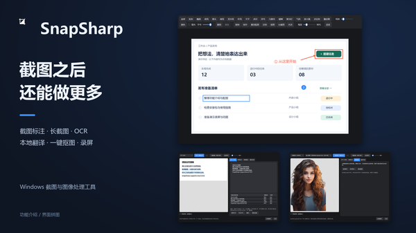

| 想完成的事情 | SnapSharp 提供的功能 |
|---|---|
| 说明界面问题、制作教程配图 | 区域截图、箭头、文字、序号、马赛克、模糊等标注 |
| 从图片里拿到可编辑的内容 | 中英文 OCR、表格转 CSV / XLSX、公式转 LaTeX |
| 阅读外文资料 | OCR 后翻译，支持本地 Qwen 模型与可选在线服务 |
| 分离图片主体 | 一键抠图、透明背景预览与 PNG / WebP 输出 |
| 边看资料边工作 | 图片、文字和颜色贴图，置顶、缩放、透明度与分组 |
| 保留连续内容或演示操作 | 滚动长截图、MP4 录屏与 GIF 动图 |

[截图标注](#selection) · [AI 图像处理](#recognition) · [桌面贴图](#pins) · [长截图](#scrolling) · [录屏](#recording) · [快速上手](#start)

## 1. 截图后，直接把重点说明白

按 `Ctrl+Shift+A` 框选区域，就可以在截图上继续标注。矩形、椭圆、箭头、文字、序号和荧光笔可以组合使用；需要遮挡内容时，可以选择马赛克或模糊。

标注支持选择、移动、缩放、旋转、调整层级，以及撤销和重做。除了矩形选区，还支持椭圆、自由套索和多边形选区，适合截取不同形状的内容。

  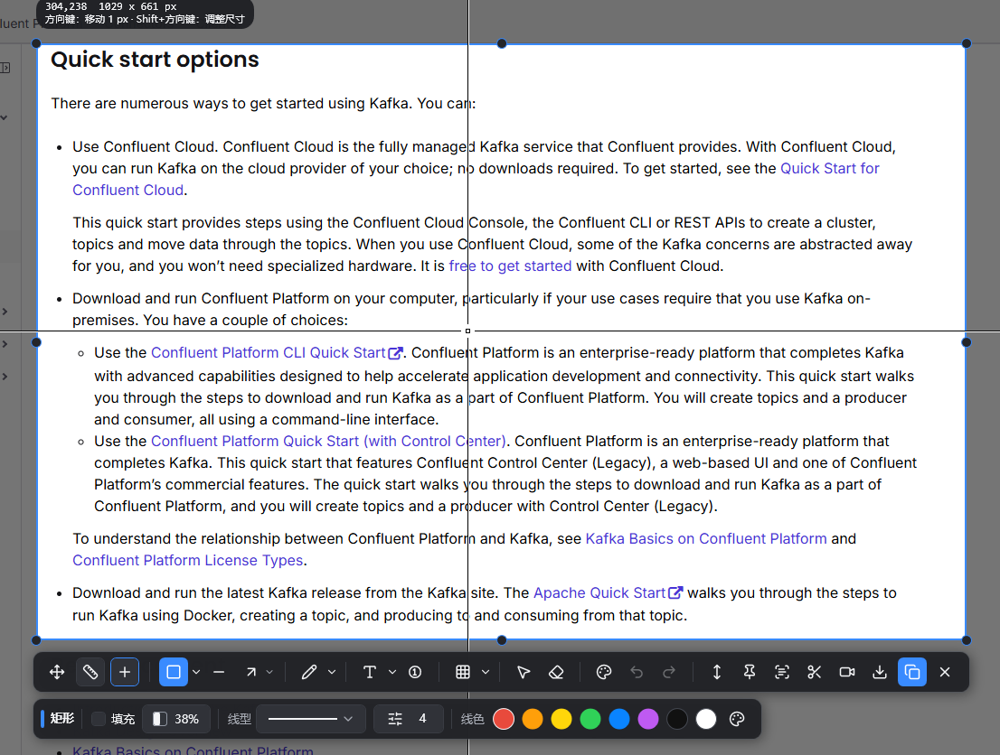

<em>框选区域时即可使用截图工具栏，选择标注工具或下一步处理操作。</em>

  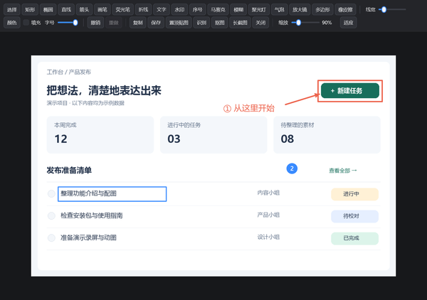

<em>示例配图：用箭头指明入口，用矩形框出任务，再用文字补充说明。</em>

  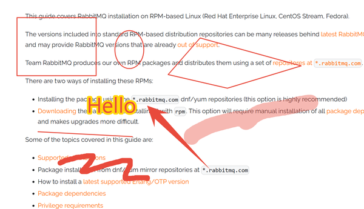

<em>在 RabbitMQ 文章截图上组合箭头、高亮和文字，直接说明需要关注的内容。</em>

完成后可以复制、保存、置顶贴图，或继续识别文字、抠图。尚未框选时，鼠标旁的放大镜还能显示像素网格与颜色值，按 `C` 可复制当前色值。

## 2. 本地 AI：把图片变成可继续使用的内容

复制图片后，从托盘打开“识别粘贴板图片…”，即可选择文字 OCR、表格、公式或一键抠图。截图选区、贴图和编辑器也提供相应入口。

这些功能需要先下载对应模型；配置完成后，OCR、表格、公式、抠图和本地翻译均可在本机处理。普通截图与标注可以直接使用。

  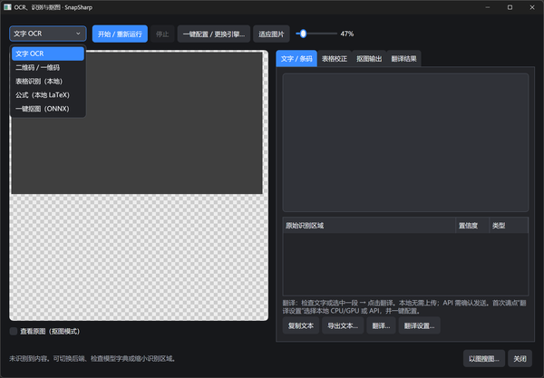

<em>统一识别窗口：从模式列表切换文字、条码、表格、公式与一键抠图。</em>

### 中英文 OCR：从图片里提取文字

资料截图、操作说明和图片中的段落，可以先交给 OCR，再复制或导出文本。左侧识别框与右侧文本、原始识别行可以相互定位，便于对照校对。

  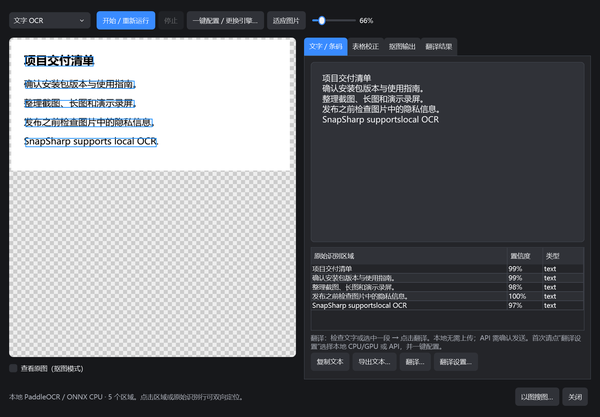

<em>中文示例：本地 PaddleOCR 识别多行文字，结果可继续编辑、复制或导出。</em>

  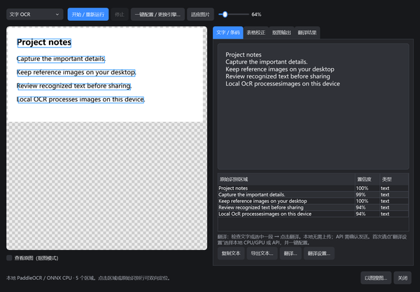

<em>英文示例：本地 PaddleOCR 提取项目说明，右侧可对照文本和各行置信度。</em>

  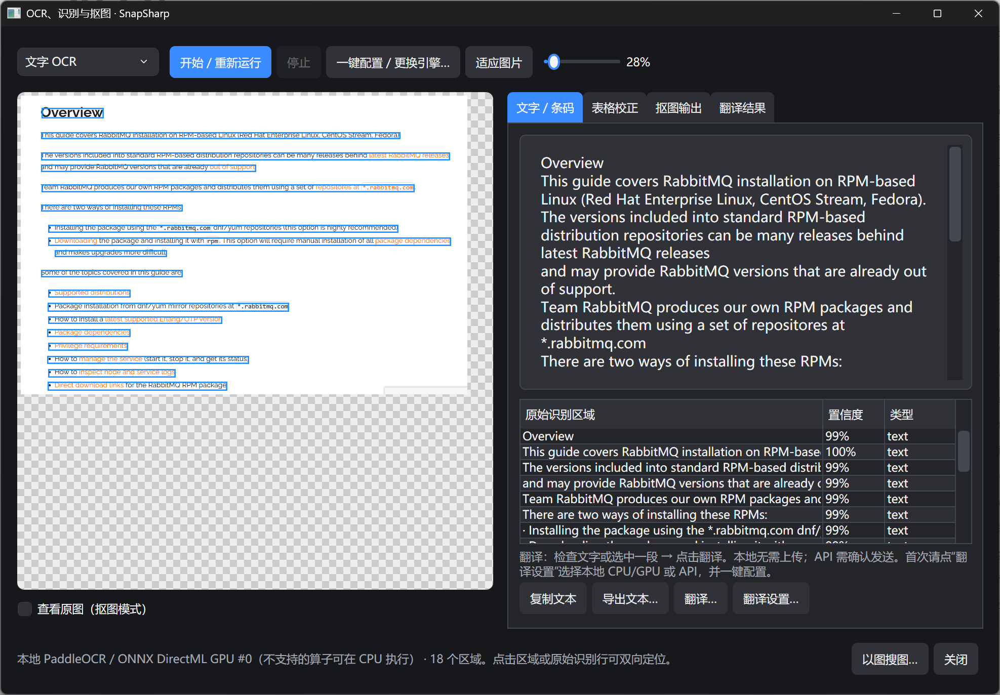

<em>较长英文资料的识别示例：左侧显示文字定位框，右侧集中查看识别文本和原始行。</em>

软件提供 PaddleOCR、Windows OCR 和 Tesseract 三种本地引擎。PaddleOCR 与抠图支持选择 CPU 或 DirectML GPU。识别结果仍需检查，尤其是空格、标点和复杂排版。

### 本地翻译：提取文字后，接着阅读译文

OCR 后点击“翻译…”，可以处理全文或选中的一段文字。本地翻译使用 Qwen 模型与 llama.cpp，支持 CPU 或 Vulkan GPU；模型下载完成后，文字无需发送到外部服务。

  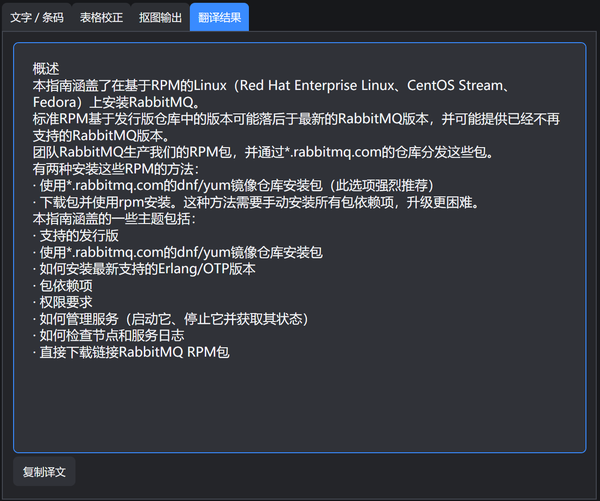

<em>已有本地翻译结果的局部展示；可对照<a href="Screenshot/6.png">完整原文与翻译界面</a>阅读。</em>

  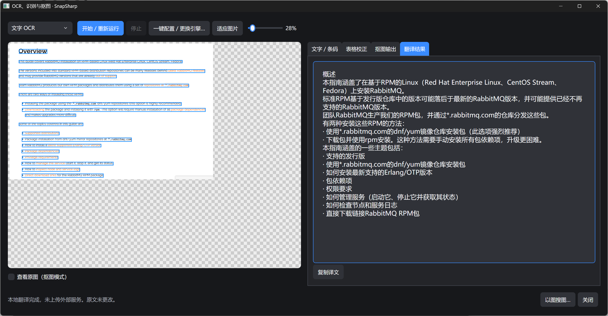

<em>完整翻译界面：对照 RabbitMQ 英文资料、OCR 内容与已有的本地中文译文。</em>

也可以按需选择 MyMemory、Google 网页适配或 LibreTranslate 等在线服务。在线发送需要主动启用并确认；小模型译文和 OCR 原文都应核对。

### 表格识别：从截图走向 CSV / Excel

遇到表格图片，可以用本地 SLANet 识别结构，并结合 OCR 匹配单元格文字。结果页支持检查和修正行、列、跨行、跨列及文本，再导出 CSV 或 XLSX。

  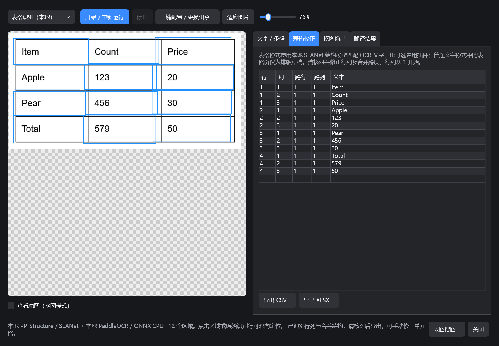

<em>示例表格实际识别为 4 行 × 3 列；右侧可核对单元格内容并导出。</em>

### 公式识别：把公式图片转成 LaTeX

框选单个公式后，选择“公式（本地 LaTeX）”，就可以获得可编辑、可复制的 LaTeX，也能导出 `.tex` 文件，方便继续写作和排版。

  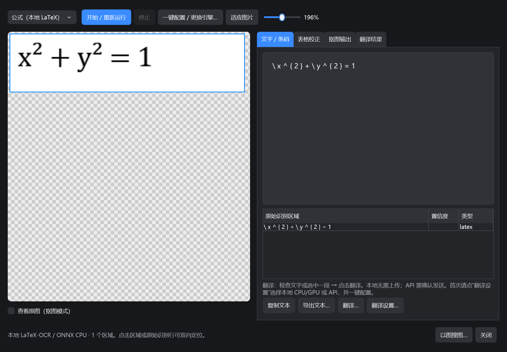

<em>圆方程示例：左侧为公式图片，右侧为实际模型输出，使用前可继续调整排版与校对。</em>

### 一键抠图：留下主体，去掉背景

切换到“一键抠图（ONNX）”，选择已配置的模型后运行。棋盘格表示透明区域，可以勾选“查看原图”对比，完成后复制图片、保存或置顶贴图。

  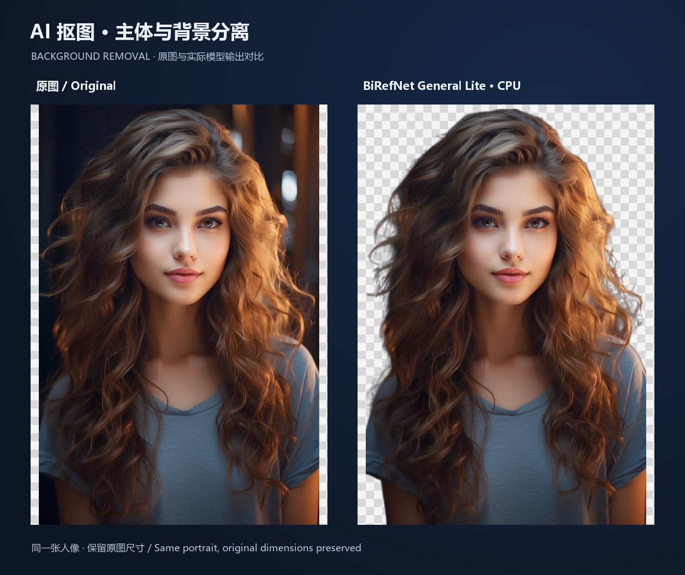

<em>同一张人像的原图与实际抠图结果：BiRefNet General Lite，CPU 推理，保留原图尺寸。</em>

  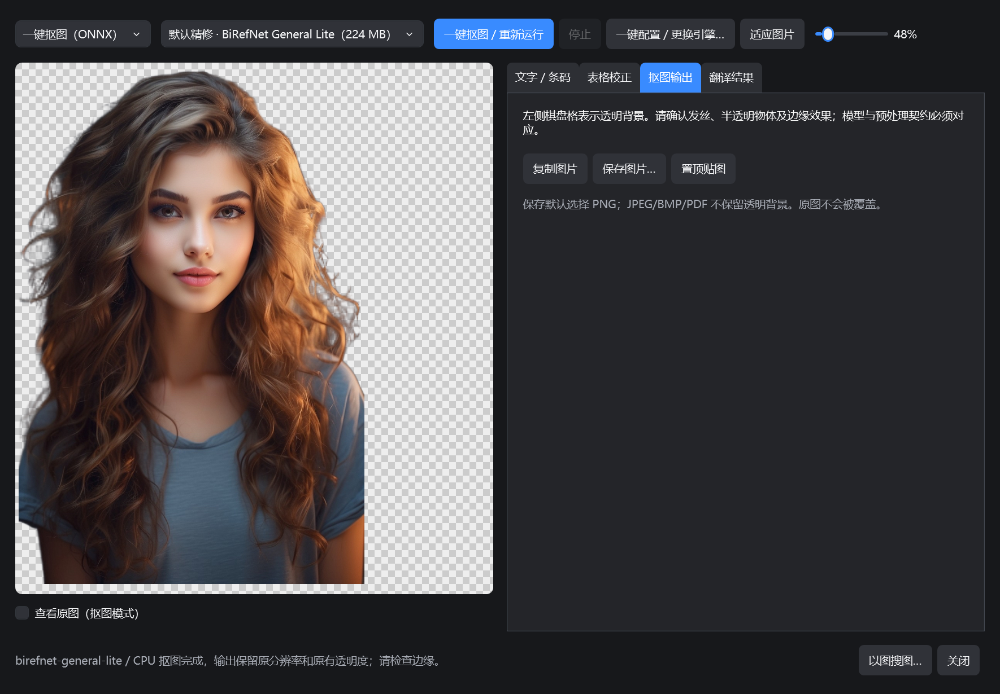

<em>在抠图窗口检查边缘，再复制、保存或直接贴到桌面。</em>

模型可按用途选择：U²-Net 轻量模型适合快速尝试，BiRefNet General Lite 适合日常使用，还提供人像、Matting 和 HR 等选项。透明背景建议保存为 PNG 或支持透明度的 WebP。发丝、玻璃和半透明边缘需要检查，大模型的资源要求与已知限制见[使用指南](docs/使用指南.md#cutout)。

此外，软件还能识别二维码／一维码，并支持本次会话内的屏幕悬停取词。条码识别不需要下载 AI 模型。

## 3. 把参考图片、文字和颜色放在桌面上

复制图片后按 `Ctrl+Shift+V`，可以创建置顶贴图。文字和颜色也能做成贴图，适合一边看参考资料、一边写代码、整理文章或调整设计。

  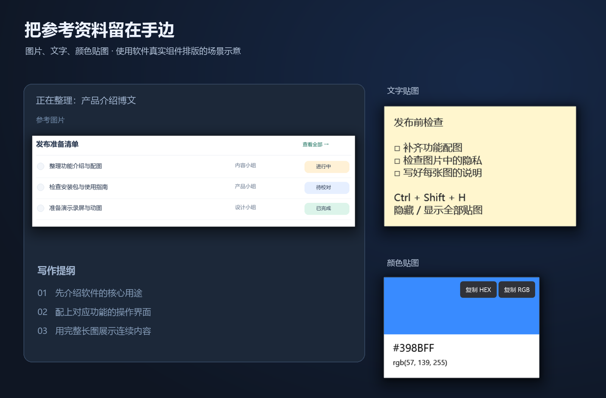

<em>贴图场景示意：把参考图片、待办清单和色值留在手边。</em>

滚轮缩放贴图，`Ctrl+滚轮` 调整透明度，`Ctrl+Shift+H` 隐藏或显示全部贴图。右键还可以编辑标注、旋转、分组、开启鼠标穿透，或继续识别和抠图。

  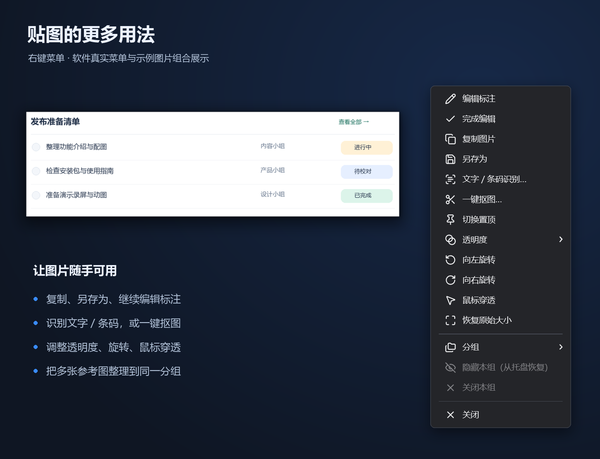

<em>贴图右键菜单：继续编辑、识别或抠图，也可调整透明度、旋转、鼠标穿透和分组。</em>

  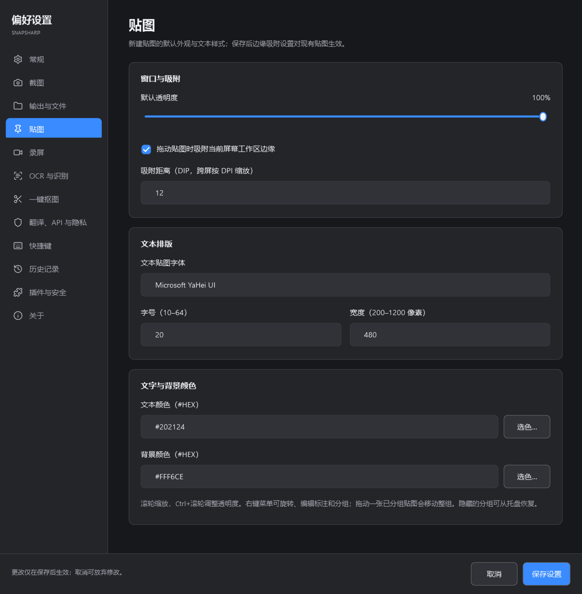

<em>贴图设置：集中调整透明度、边缘吸附，以及文本贴图的字体、字号和背景颜色。</em>

## 4. 超出一屏的内容，拼成完整长图

网页、列表和连续资料可以通过滚动长截图保留下来。选好区域后缓慢滚动，采集完成再进入预览，检查接缝、裁掉边缘，或继续添加标注。

  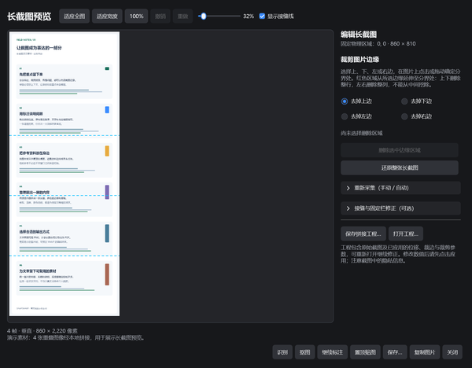

<em>重叠示例图经软件拼接后的预览；可检查接缝、裁边并继续输出。<a href="Screenshot/Blog/03-long-image-result.png">查看完整长图</a>。</em>

  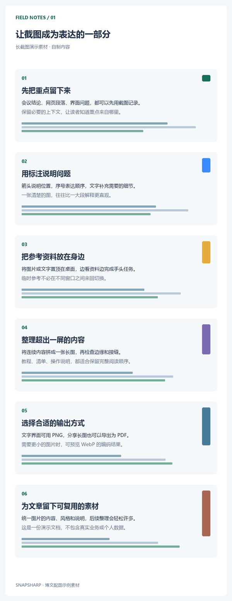

<em>完整拼接结果：四张重叠示例图经软件拼接，输出为 860 × 2220 像素长图。</em>

手动模式监听滚动，完成时点击 `√`；自动模式会发送滚轮操作。拼接工程可保存为 `.ssscroll`，以后重新打开继续修正。

## 5. 操作演示，可以录成 MP4 或 GIF

需要展示连续操作时，可以录制单屏矩形区域。MP4 支持可选音频，GIF 适合简短、无声的操作演示；还可以设置倒计时、光标显示、点击高亮与定时停止。

  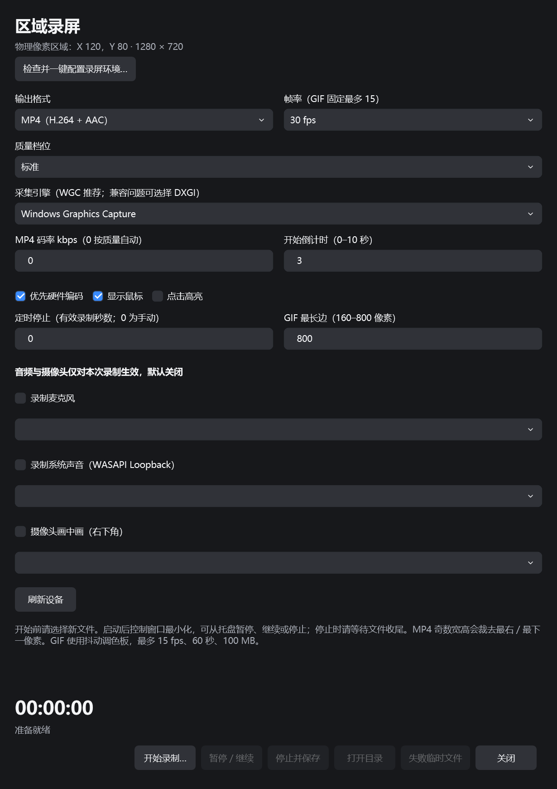

<em>MP4 录制配置；目标帧率可选 15／30／60 fps，实际表现取决于采集与编码性能。</em>

  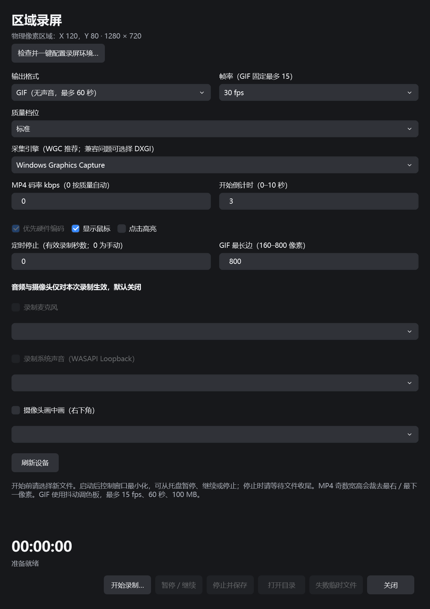

<em>GIF 录制配置：用于简短无声演示，界面会禁用不适用的音频等参数。</em>

  

<em>悬浮工具条集中提供开始、暂停、停止和配置入口。</em>

音频与摄像头首次使用时默认关闭，之后记住上次的开关与设备选择。系统声音默认跟随 Windows 当前默认输出设备，也可以手动指定。可在“设置 → 输出与文件”中配置独立的录屏保存目录，录制时自动生成文件名，无需每次选择位置。GIF 不含声音，最高 15 fps，最长 60 秒。首次使用可通过“一键配置录屏环境”检查所需组件。

## 6. 保存前，选好格式和尺寸

截图、贴图、编辑器和长截图共用输出窗口。PNG 适合界面文字与透明图片，JPEG 适合照片，WebP 提供有损与无损模式；也支持 TIFF、BMP 和 A4 分页 PDF。

  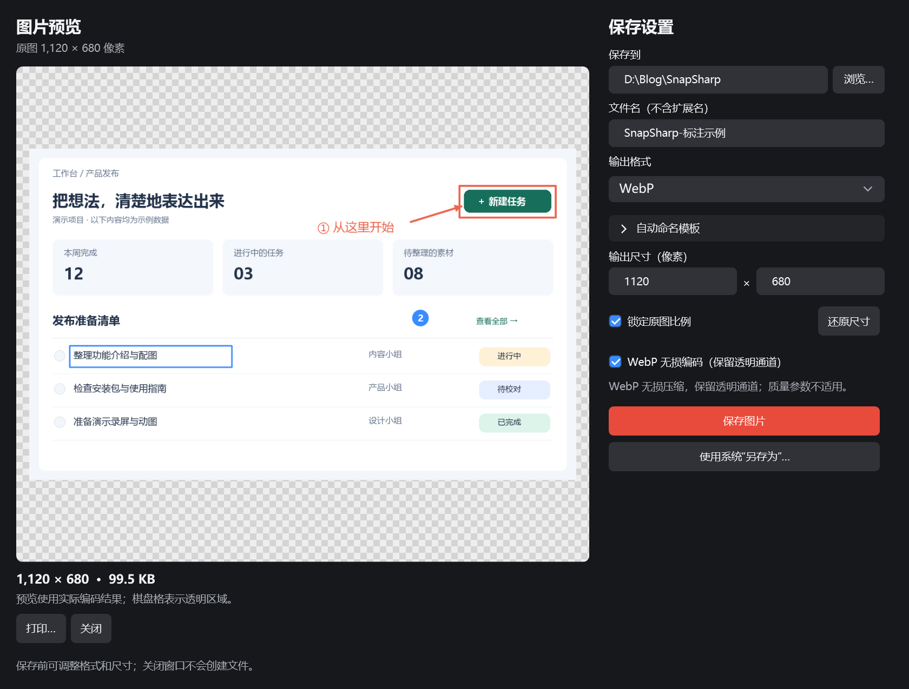

<em>实际编码预览帮助确认图片效果、像素尺寸和文件体积；长图也可以<a href="Screenshot/Blog/05-export-pdf.png">导出为 PDF</a>。</em>

  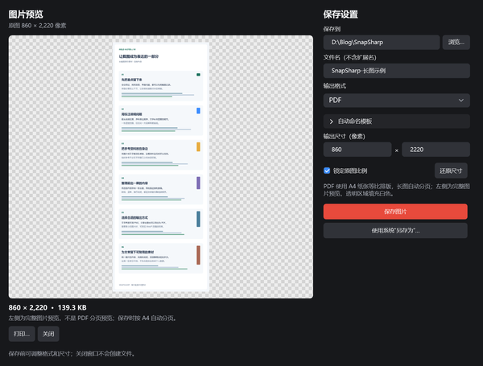

<em>PDF 输出配置：长图可按 A4 分页导出，左侧预览仍显示完整源图。</em>

需要持续整理素材时，可以配置自动保存、按日期归档和文件名模板。自动保存与截图历史是两个独立开关。

  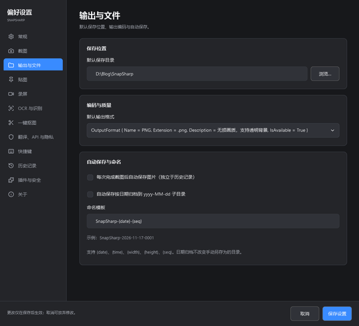

<em>输出设置：选择保存目录与默认格式，配置自动保存、日期归档和文件名模板。</em>

## 7. 下载与快速上手

从 [GitHub Releases](https://github.com/leelongjiang/SnapSharp/releases) 获取发布包，保留整个程序目录后运行 `SnapSharp.exe`。软件启动后驻留任务栏托盘，不会默认打开主窗口。

1. 按 `Ctrl+Shift+A`，框选需要的区域。
2. 添加箭头、文字、序号或马赛克。
3. 复制、保存，或选择置顶贴图。
4. 需要 AI 处理时，从托盘打开“识别粘贴板图片…”，选择模式并运行。

| 默认快捷键 | 功能 |
|---|---|
| `Ctrl+Shift+A` | 区域截图 |
| `Ctrl+Shift+F` | 全屏截图 |
| `Ctrl+Shift+W` | 当前窗口截图 |
| `Ctrl+Shift+V` | 从剪贴板创建贴图 |
| `Ctrl+Shift+H` | 隐藏／显示全部贴图 |

  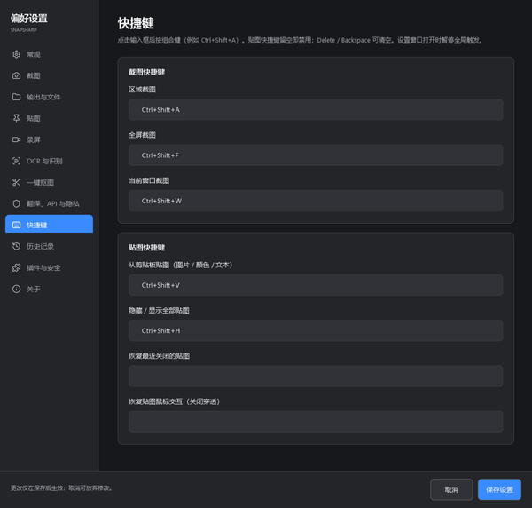

<em>快捷键设置：按自己的使用习惯调整截图、贴图和显示隐藏等操作。</em>

### 首次配置 AI 功能

在设置里为需要的功能一键下载对应模型，然后点击“保存设置”。无需一次安装全部模型，也无需另装 Python。

| 功能 | 设置入口 |
|---|---|
| 推荐中英文 OCR | OCR 与识别 → 一键配置推荐 ONNX OCR，约 14.2 MB |
| 表格与公式 | OCR 与识别 → 本地表格与公式 |
| 一键抠图 | 一键抠图 → 下载模型，再选择默认模型 |
| 本地翻译 | 翻译、API 与隐私 → 本地引擎，模型与运行库约 1.04 GiB |

  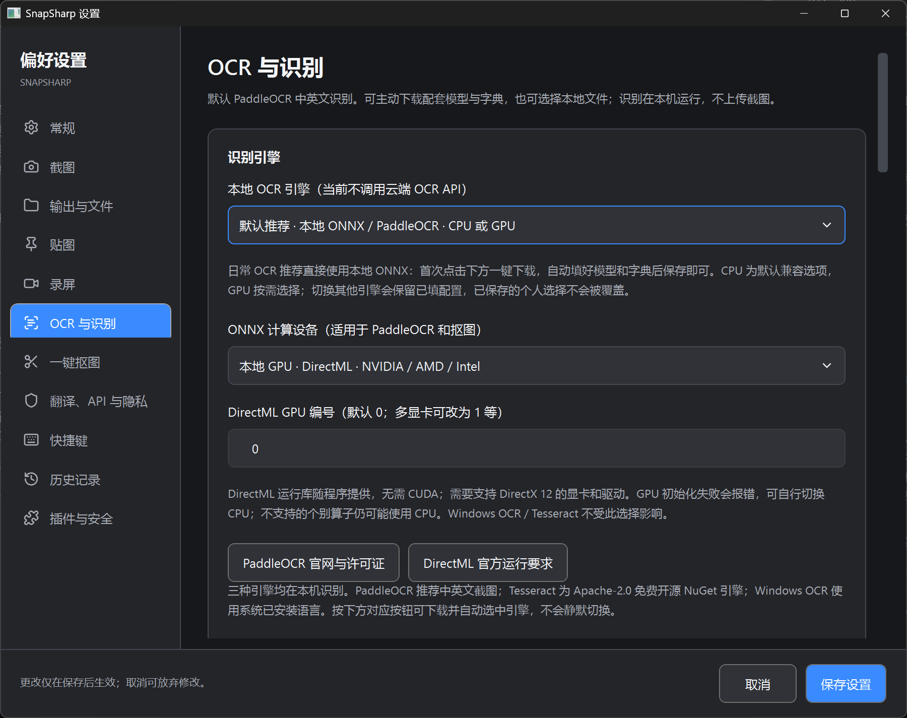

<em>OCR 与识别设置：配置识别引擎、本地模型及 CPU / DirectML 运行设备。</em>

  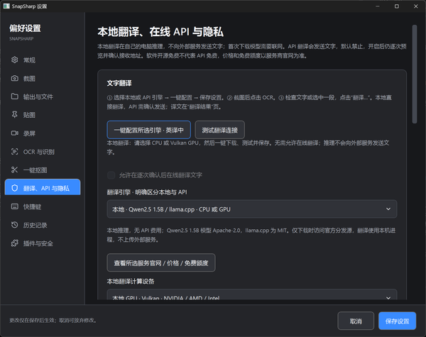

<em>翻译、API 与隐私设置：配置本地翻译运行环境，以及可选的在线服务。</em>

### 运行环境与本地数据

- Windows 10 2004 及以上版本或 Windows 11，x64。
- 自包含发布版无需另装 .NET Desktop Runtime；依赖框架版需要 .NET 10 Desktop Runtime。
- 录屏可能需要 VC++ x64 运行库与 Windows 媒体组件。
- 模型首次下载需要联网；本地 AI 处理不上传图片或文字。在线翻译、以图搜图等按需授权。

设置、模型和历史位于 `%LocalAppData%\SnapSharp`。截图历史未加密；更详细的模型选择、数据说明和故障处理见完整指南。

### 遇到问题时

启动后看不到窗口，先找任务栏托盘图标；快捷键无响应，到设置中检查冲突；AI 提示缺少模型，下载配置完成后记得保存。更多问题见[常见问题速查](docs/使用指南.md#faq)。

## 文档与开源

- [完整使用指南](docs/使用指南.md) / [English user guide](docs/UserGuide.en.md)：详细操作、首次配置与常见问题。
- [配置与依赖](docs/配置与依赖.md)：模型、运行环境与服务配置。
- [构建与测试](docs/构建与测试.md)：开发构建与验证方法。
- [文档中心](docs/README.md) · [配图说明与来源](Screenshot/Blog/README.md)。

本文配图包含示例内容、实际模型结果与标明的组合场景图。AI 输出应结合原图核对，效果随输入、模型和设备而变化。

Copyright 2026 leelongjiang and SnapSharp contributors。项目基于 [Apache License 2.0](LICENSE) 开源，第三方组件与模型的许可见 [THIRD-PARTY-NOTICES.md](THIRD-PARTY-NOTICES.md)。
