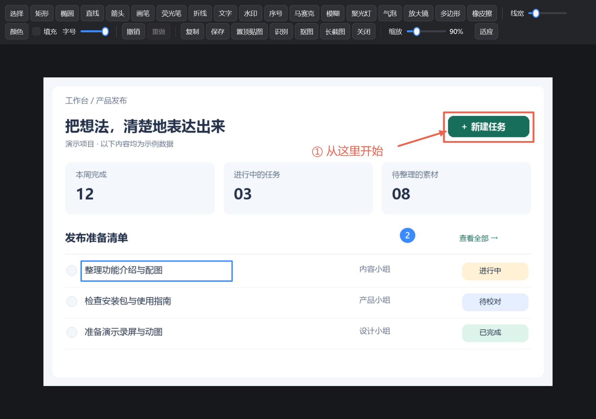

# SnapSharp 博文配图

共 21 张 PNG 配图，原有素材保留在上一级目录。本轮补充了 7 张 AI 相关配图，先看 [AI 配图总览](AI配图总览.jpg)、[完整配图总览](配图总览.jpg)，或打开[图片画廊](index.html)逐张浏览。21 张配图已全部嵌入中英文 README，并结合 7 张原有截图，分别展示 28 张图片。

## 一篇介绍文章怎么搭配

中英文 README 采用完整图文介绍：按截图标注、AI 识别与翻译、桌面贴图、长截图、录屏、导出和首次配置分节展示。21 张配图全部在对应章节直接展开，长图结果、GIF / PDF 配置和设置页面也可直接阅读。

OCR 使用本次生成的中文或英文识别结果，表格与公式各有单独的处理结果图；抠图提供 General Lite 的实际结果与原图对比。本地翻译展示已有 [6.png](../6.png) 的结果局部，并保留完整界面入口。

## 配图与可直接使用的图注

| 文件 | 适合位置 | 建议图注 |
|---|---|---|
| [00-cover.png](00-cover.png) | 文章封面 | SnapSharp：从截图标注，到 OCR、抠图与录屏。 |
| [01-annotation-editor.png](01-annotation-editor.png) | 截图与标注 | 用矩形框出重点，配合箭头、文字和序号，把操作说明直接写在截图上。 |
| [02-scrolling-preview.png](02-scrolling-preview.png) | 长截图 | 长截图预览集中提供裁边、接缝检查、继续标注和输出入口。 |
| [03-long-image-result.png](03-long-image-result.png) | 长图效果补充 | 将连续内容拼成一张完整长图，适合整理教程、清单与阅读材料。 |
| [04-export-webp.png](04-export-webp.png) | 图片输出 | 保存前可以调整格式与尺寸，并预览 WebP 无损编码后的图片和体积。 |
| [05-export-pdf.png](05-export-pdf.png) | 长图分享 | 长图也能选择 PDF 输出，按 A4 分页；左侧预览仍展示完整图片。 |
| [06-recording-mp4.png](06-recording-mp4.png) | 录屏介绍 | MP4 录制配置提供帧率、采集引擎、倒计时、光标及音频选项。 |
| [07-recording-gif.png](07-recording-gif.png) | GIF 动图 | 简短操作演示可以选择 GIF；GIF 不含声音，界面会禁用不适用的参数。 |
| [08-recording-toolbar.png](08-recording-toolbar.png) | 录屏操作补充 | 悬浮工具条集中放置开始、暂停、停止和配置入口。图中为准备录制状态。 |
| [09-output-settings.png](09-output-settings.png) | 自动保存 | 保存目录、默认格式、自动保存、日期归档和文件名模板可集中设置。 |
| [10-pin-settings.png](10-pin-settings.png) | 贴图设置补充 | 贴图可设置透明度、边缘吸附，以及文本的字体、字号和背景颜色。 |
| [11-keyboard-shortcuts.png](11-keyboard-shortcuts.png) | 快速上手 | 区域截图、全屏截图和桌面贴图都能通过快捷键快速调用。 |
| [12-pin-workspace.png](12-pin-workspace.png) | 桌面贴图主图 | 把参考图片、待办文字和颜色样本放在手边，减少窗口之间的来回切换。图为贴图场景示意。 |
| [13-pin-context-menu.png](13-pin-context-menu.png) | 贴图进阶 | 贴图右键菜单提供编辑、识别、抠图、透明度、旋转、鼠标穿透与分组操作。 |
| [14-ai-ocr-chinese.png](14-ai-ocr-chinese.png) | AI / 中文 OCR | 中文清单经本地 PaddleOCR 识别后，可以对照识别框、文本和置信度校对。 |
| [15-ai-ocr-english.png](15-ai-ocr-english.png) | AI / 英文 OCR | 英文段落可在本机提取为可编辑文本，再复制、导出或翻译。 |
| [16-ai-table-recognition.png](16-ai-table-recognition.png) | AI / 表格 | 本地 SLANet 与 PaddleOCR 实际识别 4 行 × 3 列示例，结果可修正并导出 CSV / XLSX。 |
| [17-ai-formula-latex.png](17-ai-formula-latex.png) | AI / 公式 | 左侧公式图片由本地 LaTeX-OCR 转为右侧原始 LaTeX 输出，支持继续编辑与导出。 |
| [18-ai-cutout-result.png](18-ai-cutout-result.png) | AI / 抠图界面 | BiRefNet General Lite 在 CPU 上的实际抠图结果，检查边缘后可以复制、保存或贴图。 |
| [19-ai-cutout-comparison.png](19-ai-cutout-comparison.png) | AI / 抠图对比 | 同一张人像的原图与 General Lite 实际透明结果对比，保留原图尺寸。 |
| [20-ai-local-translation.png](20-ai-local-translation.png) | AI / 本地翻译 | 已有本地翻译截图的结果局部，展示英文安装说明的中文译文；本次未重新运行翻译模型。 |

## Markdown 插图示例

在当前目录使用：

```markdown


*用矩形框出重点，配合箭头、文字和序号，把操作说明直接写在截图上。*
```

上传到博客时，把图片路径替换为博客图床地址。封面适合横向展示；03 是完整长图，08 是较窄的工具条局部，其余图片建议保持原始比例。

## 图片来源与制作范围

- 01、02、04–11 使用项目现有 Release 版本（1.0.4）的真实 WPF 窗口内容渲染，采用软件自身样式与控件，以 150% 比例输出。它们展示界面内容区域，不包含 Windows 标题栏，也不是桌面操作实拍。
- 标注底图、任务清单和长文均为自制示例。标注通过软件的编辑模型生成，WebP 与 PDF 预览调用软件的实际编码流程。
- 长图使用 4 张重叠示例图，通过软件的匹配与拼接功能生成。三处位移均为 470 像素，匹配误差为 0，输出 860 × 2220 像素；这演示拼接与预览，不代表真实网页滚动采集的实测。
- 00 为界面拼图封面，使用新增标注、OCR 和抠图界面；12、13 为真实贴图组件与菜单的组合展示，图内标有场景示意或组合展示。
- 录屏图片展示配置和准备状态，没有开始录制，不作为实际帧率、声音采集或编码性能的证明。
- 设置页面使用临时示例值，未读取或保存用户的持久设置。图片中的输出目录是示例路径。
- 14、15 由软件现有 PaddleOCR 检测、识别模型在 CPU 上处理自制样本文字，各识别出 5 个区域。实际输出保留空格、标点和大小写误识别，未用人工文本替换模型结果。
- 16 使用软件固定版本的 SLANet 模型与 PaddleOCR，在 CPU 上识别出 4 行 × 3 列，共 12 个单元格。
- 17 使用固定版本的 LaTeX-OCR 编码器、解码器和尺寸预测模型，识别 `x² + y² = 1`。界面保留模型原始的空格及 LaTeX 间距命令，未人工改成理想输出。
- 18 使用 BiRefNet General Lite、1024 输入与 CPU 推理，对原有 `3.png` 人像重新执行抠图。19 将该真实输出与原图并排，透明区域叠加棋盘格用于展示；没有手工修改蒙版。
- 本轮新增表格、公式、General Lite 模型均与软件固定下载定义的校验值一致；模型文件留在本地工具目录，不在配图包中分发。
- 20 仅裁取原有 `6.png` 的翻译结果面板，未生成或修改译文，也未重新运行 Qwen。原有其他截图保留原样。
- 14–18 的窗口使用真实识别流程获得结果后，再以真实 WPF 组件渲染，仍不属于桌面操作实拍。可查看 [AI 制作记录](AI制作记录.txt) 中的实际模型文本与表格尺寸。
