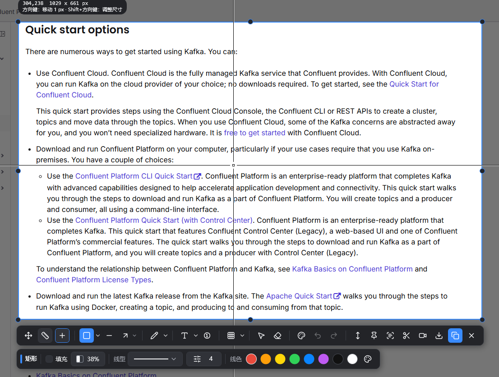
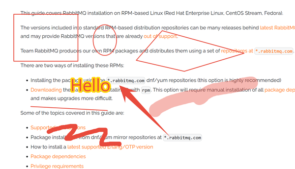
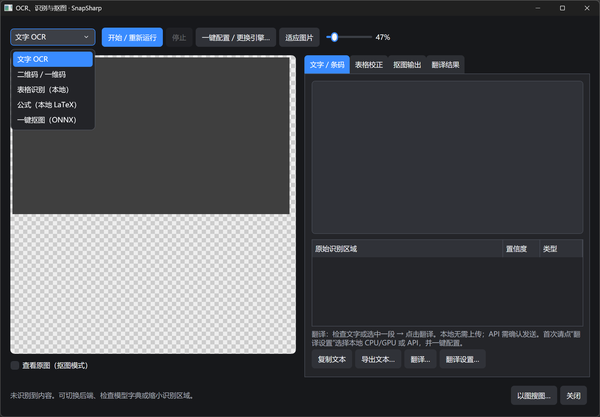
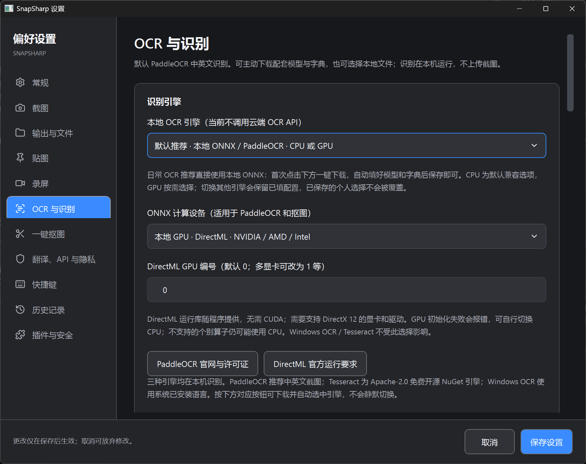
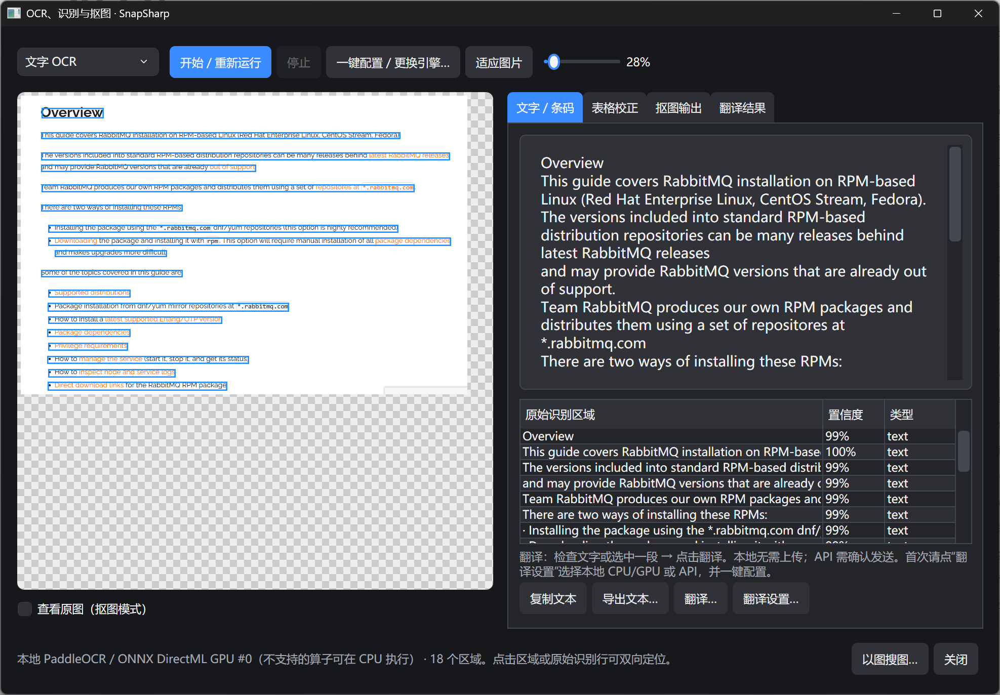
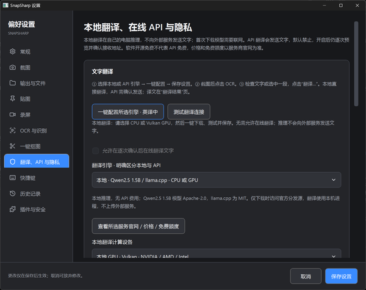
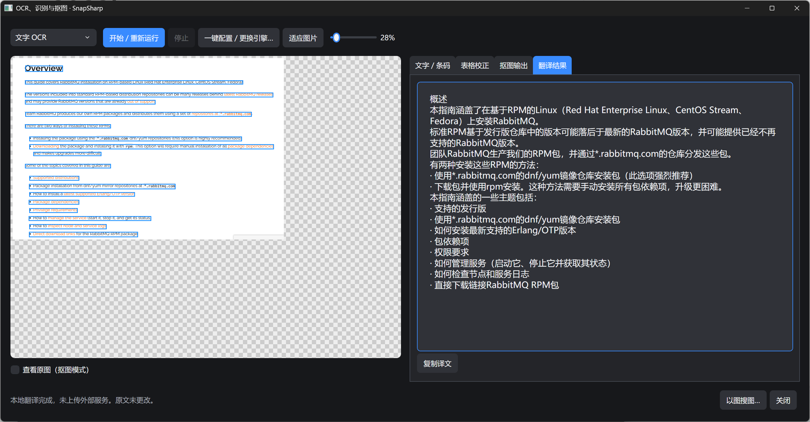
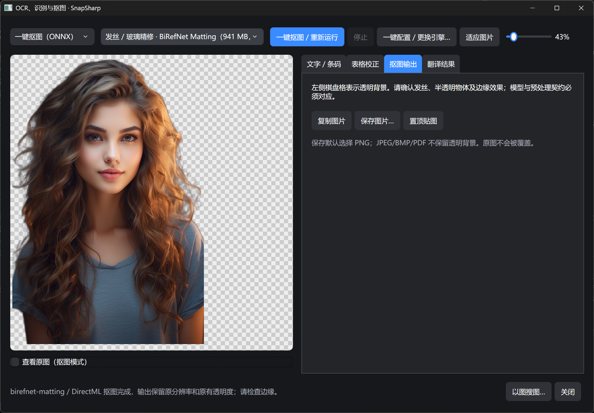

# SnapSharp 使用指南：截图、长截图、OCR、翻译、抠图与录屏

**简体中文** | [English](UserGuide.en.md)

项目地址：[GitHub](https://github.com/leelongjiang/SnapSharp) | [Gitee](https://gitee.com/lilongjiang/SnapSharp)

SnapSharp 是一款 Windows 截图与图像处理工具。除了截图、画箭头和打马赛克，还能把图片置顶贴在桌面上、拼接长截图、识别图片文字、翻译、抠出透明背景，以及录制 MP4 或 GIF。

软件启动后驻留在任务栏托盘，不会默认打开主窗口。日常使用可以从快捷键开始，也可以右键点击托盘图标选择功能。

## 先用一分钟完成第一张截图

1. 启动 `SnapSharp.exe`，在任务栏右下角找到托盘图标；看不到时展开隐藏图标。
2. 按 `Ctrl+Shift+A`，拖动鼠标框选需要的区域。
3. 在选区旁的工具栏选择箭头、文字或马赛克，直接在截图上标注。
4. 双击选区或点击复制，将结果粘贴到聊天窗口或编辑器；也可以点击保存，或选择置顶贴图。
5. 不需要这次截图时，按 `Esc` 取消。

截图、标注和保存不需要先下载 AI 模型。OCR、抠图和本地翻译需要在首次使用前配置对应模型，下载一次后即可在本机处理。

<a id="start"></a>

## 1. 启动、退出与快捷键

### 运行环境

SnapSharp 运行于 Windows 10 2004 及以上版本或 Windows 11，目前提供 x64 程序。

- 使用自包含发布版时，不需要另装 .NET Desktop Runtime；请保留整个程序目录，不要只拷贝 EXE。
- 使用依赖框架的版本时，需要安装 .NET 10 Desktop Runtime。
- 录屏等原生功能可能需要 VC++ x64 运行库及 Windows 媒体组件。
- 模型首次下载需要联网；本地截图、OCR、抠图和本地翻译不需要把内容上传。

双击程序后没有弹出窗口是正常现象。右键托盘图标，可以找到截图、识别粘贴板图片、长截图、录屏、贴图、截图历史和设置。

托盘菜单、窗口菜单和贴图右键菜单均带有对应的功能图标。箭头表示还有子菜单，勾号表示当前启用或选中的状态；灰色项目暂时不可用。

### 默认快捷键

| 快捷键 | 功能 |
|---|---|
| `Ctrl+Shift+A` | 区域截图 |
| `Ctrl+Shift+F` | 全屏截图 |
| `Ctrl+Shift+W` | 当前窗口截图 |
| `Ctrl+Shift+V` | 从剪贴板创建贴图 |
| `Ctrl+Shift+H` | 隐藏／显示全部贴图 |

在“设置 → 快捷键”中可以修改。注册冲突时会提示，换一个未被其他软件占用的组合后重新保存即可。恢复最近关闭贴图、恢复鼠标交互等可选快捷键可以留空。

托盘还提供 3、5、10 秒延时截图，适合截取菜单、提示框等需要先展开的界面；等待期间可以取消。

要关闭软件，请右键托盘图标选择“退出”。录屏时应先停止并等待文件保存，不要直接结束进程。需要开机启动时，可在设置中开启 Windows 登录时启动。

<a id="selection"></a>

## 2. 截图后直接标注

区域截图支持矩形、椭圆、自由套索和多边形选区。选择区域后，可以直接在截图上编辑，不必先打开另一个编辑窗口。

工具栏分为两层：主工具栏负责选择工具和输出动作，参数工具栏负责颜色、粗细、线型、填充、字体等选项。部分工具放在分组下拉菜单里，主按钮会复用该组最近使用的工具。

常用工具包括矩形、椭圆、箭头、画笔、荧光笔、文字、气泡、序号、水印、马赛克、模糊、聚光灯和放大镜。已有标注可以选择、移动、缩放、旋转及调整层级，也支持撤销和重做。

<p align="center">
  
</p>
<p align="center"><em>选区、尺寸提示、标注工具和输出操作集中在同一个覆盖层中。</em></p>

<p align="center">
  
</p>
<p align="center"><em>矩形、椭圆、箭头、文字、画笔和高亮等标注可以组合使用。</em></p>

选区不合适时，右键会放弃当前选区和标注，让你在同一张桌面快照上重新框选；按 `Esc` 则取消整个截图。

保存或复制时输出的是最终合成图像，不是工具栏和预览界面的截屏。标注模板仅保存对象和样式，不包含截图底图。

### 自动选中按钮、输入框等元素

按 `Ctrl+Shift+A` 开始截图后，默认进入“元素”模式。鼠标悬停在按钮、输入框、链接或其他可识别控件上，会自动吸附并高亮其边界，同时显示控件类型、名称和尺寸。需要其他模式时，可按 `Tab` 或使用顶部捕获模式选择器切换。

- 单击锁定当前元素，随后可以标注、复制、保存或置顶贴图；输出仅包含所选边界内的画面。
- 滚轮向下扩大到父级容器、窗口内容和整个窗口，向上缩小到子元素。
- 也可以直接拖动框选区域。`Tab` 依次切换“区域 → 元素 → 窗口 → 全屏”。
- 识别失败或响应较慢时，仍可选择窗口或手动框选。选区后右键可重新选择，`Esc` 取消截图。

浏览器不需要安装扩展。浏览器通过系统辅助功能接口暴露的网页按钮、链接、输入框等也可以悬停选择；具体覆盖范围取决于浏览器和页面。此模式不支持输入 CSS 选择器、读取完整 DOM 或导出视口外的完整元素。自绘控件、Canvas 和未暴露辅助功能的内容可能只能选到外层容器。

截图使用开始截图时的桌面快照，保留元素可见区域内的实际背景和遮挡内容，不自动生成透明背景。跨显示器元素仅截取当前显示器内的部分；目标窗口移动后，需重新开始截图以更新底图和边界。

### 顺手取一个屏幕颜色

在尚未开始选区时，鼠标旁的放大镜会显示像素网格、屏幕坐标和颜色值。

- 按 `Shift`，依次切换 HEX、RGB、RGBA、HSL、HSV/HSB、CMYK 和颜色名称。
- 按 `C`，复制当前格式的颜色值，并退出截图，不生成图片。
- 每次新截图默认使用 HEX。拖动选区时，`Shift` 用于锁定比例，不切换颜色格式。

屏幕快照无法还原窗口原本的透明度，所以 RGBA 的 alpha 为 1。颜色名称可能是最接近的近似名称；CMYK 是 RGB 换算值，不代表经过印刷色彩配置的结果。

<a id="output"></a>

## 3. 复制、保存与图片格式

截图、贴图、历史和编辑器共用保存窗口。保存前可调整像素尺寸、保持比例，并查看实际编码结果。

| 格式 | 怎么选 |
|---|---|
| PNG | 文字截图、界面截图、透明抠图，优先选择 |
| JPEG | 照片或不需要透明背景的图片；有损压缩，透明部分填白 |
| WebP | 希望缩小体积时使用；支持有损和无损两种模式 |
| TIFF | 无损输出，写入 300 DPI 信息，但不会因此增加像素细节 |
| BMP | 通常文件较大，透明部分填白 |
| PDF | A4 分页输出，长图自动分段；保存窗口左侧仍预览完整图片 |

WebP 的质量 100 不等于无损模式。需要无损时，请明确勾选无损选项。AVIF 当前不提供编码。

保存后可复制文件、复制路径、在资源管理器中定位或打印。替换已有文件需要确认。图片输出每边最多 16384 像素，总计最多 6400 万像素。

### 自动保存和历史记录

自动保存与截图历史是两个独立开关。自动保存默认关闭，可以在设置中指定保存目录、日期归档及文件名模板，例如：

```text
SnapSharp-{date}-{time}-{seq}
```

模板支持 `{date}`、`{time}`、`{width}`、`{height}` 和 `{seq}`。自动命名冲突时会追加后缀；日期归档用于自动保存，不影响手动另存为。

<a id="pins"></a>

## 4. 把图片或文字贴在桌面上

贴图可以让图片、文字或颜色置顶显示，适合一边看参考资料、一边操作其他窗口。

复制一张图片后按 `Ctrl+Shift+V`，即可创建贴图。也可以在截图工具栏选择置顶，或从托盘“贴图”菜单新建文本贴图、颜色贴图。

| 操作 | 效果 |
|---|---|
| 滚轮 | 缩放贴图，范围 10%–1000% |
| `Ctrl+滚轮` | 调整窗口透明度，范围 20%–100% |
| 右键 | 编辑、复制、保存、旋转、鼠标穿透、分组、识别及抠图 |
| `Ctrl+Shift+H` | 隐藏／显示全部贴图 |

缩放和窗口透明度不改变保存图片的实际像素；旋转会体现在复制和保存的结果中。

文本贴图的字体、宽度、前景色和背景色可以在“设置 → 贴图”中调整。颜色贴图可以复制 HEX 或 RGB 色值。贴图分组只在本次会话有效，移动组内贴图会带动整组。

开启鼠标穿透后，鼠标会直接操作后面的窗口。如果贴图突然“点不到”，从托盘“贴图 → 关闭贴图鼠标穿透”恢复。误关贴图时，可尝试“恢复最近关闭的贴图”。

<a id="scrolling"></a>

## 5. 截取网页、列表和聊天记录长图

### 最常用的手动长截图

1. 右键托盘，选择“长截图 → 选择区域并开始长截图…”。也可以在普通截图选区工具栏点击“滚动长截图”。
2. 框选需要采集的内容，调整边缘，点击“开始长截图”或按 Enter 确认。
3. 将鼠标放到区域内，缓慢向下滚动。需要横向长图时向右滚动，前提是目标应用支持相应的横向滚动操作。
4. 采集中会持续显示蓝色区域边框、四角及四边中点的八个圆形锚点，便于确认正在滚动哪个区域；边框鼠标穿透，不遮挡区域内的点击和滚轮。保持窗口和选区位置不变，首个有效匹配会确定拼接方向。
5. 完成后点击区域右上方的 `√`，进入预览；点击 `×` 或按 `Esc` 则丢弃本次采集。
6. 在预览中检查接缝，按需裁边，然后复制、保存、贴图或继续标注。

手动模式只监听你的滚动，不会替你发送滚轮操作。页面到底或暂时不滚动时，不会自动结束，请手动点击 `√`；托盘“停止当前采集并预览”也能结束。

滚动期间的锚点用于标示固定区域，不支持拖动调整。需要更改区域时，请停止后重新框选，避免采集中改变坐标导致错位。自动采集同样显示区域边框；完成、取消或失败后边框会移除，不进入最终长截图。

滚动过快而无法匹配时，当前帧不会追加。可以回到上一次位置附近，再慢一点滚动。固定导航栏、动画、视频和动态加载内容都可能影响拼接。

### 裁边、修正和重新采集

预览中选择上、下、左或右边，再在图片上点击或拖动确定删除范围。裁剪只能从边缘开始，不能从图片中间挖除；可以多次裁边，也能还原完整截图。

展开接缝修正后，可以查看原始帧、微调位移，或排除每帧的固定栏后重新匹配。裁剪和接缝调整支持最多 20 步撤销／重做。诊断线和红色提示不会进入输出图片。

右侧“重新采集（手动／自动）”可以重新框选。自动模式会发送滚轮操作，手动模式只监听实际操作；取消重新采集会保留当前预览。

需要以后继续编辑，可以保存为 `.ssscroll` 拼接工程。工程包含原始截图帧和调整参数，不只是最终长图；分享前注意截图中的隐私内容。

长截图单帧最多 1600 万像素，原始帧合计最多 4800 万像素。输出每边最多 16384 像素、总计最多 6400 万像素，超长内容建议分段采集。采集中不要移动目标窗口或改变屏幕缩放。

<a id="recognition"></a>

## 6. 复制图片后，选择 OCR、抠图或翻译

托盘中的“识别粘贴板图片…”是复制图片后的统一处理入口。

<p align="center">
  
</p>
<p align="center"><em>同一个窗口可以切换文字 OCR、条码、表格、公式和一键抠图。</em></p>

1. 在浏览器、聊天软件或其他程序中复制图片内容。注意不是仅复制图片链接或文件路径。
2. 右键 SnapSharp 托盘图标，点击“识别粘贴板图片…”。
3. 窗口先显示图片，不自动运行识别；在顶部选择文字 OCR、条码、表格、公式或抠图模式。
4. 点击“开始／重新运行”，或抠图模式下的“一键抠图／重新运行”。

也可以先截图，再点击选区工具栏的扫描文字或剪刀图标。贴图右键、编辑器和长截图结果窗口同样提供识别、抠图入口。

翻译处理的是文字，不是直接把人像或普通图片变成译文。图片中的文字应先经过 OCR，再进行翻译。

### 第一次配置 OCR

1. 从托盘打开“设置 → OCR 与识别”。
2. 保持默认 PaddleOCR 引擎，初次建议先选 CPU。
3. 找到“PaddleOCR 模型与字典”，选择“PP-OCRv4 · 中文＋英文”。
4. 点击“一键配置推荐 ONNX OCR（下载模型）”，等待约 14.2 MB 模型包下载及校验完成。
5. 确认模型和字典路径已自动填入，点击“保存设置”。

<p align="center">
  
</p>
<p align="center"><em>OCR 引擎、ONNX 计算设备和资源限制都在“OCR 与识别”页面配置。</em></p>

不需要安装 Python 或 CUDA。也可以主动切换到使用系统语言包的 Windows OCR，或选择 Tesseract 并一键下载字库；这三种引擎都在本机处理。

### 识别、校对和翻译

打开文字图片，选择“文字 OCR”后开始。在“文字／条码”页检查结果，可以修改文字、复制或导出；点击原图识别框和识别行，可以相互定位。

<p align="center">
  
</p>
<p align="center"><em>识别框、文本结果、置信度和原图位置可以相互定位。</em></p>

确认文字后点击“翻译…”。可以翻译全文，也可以先选中一段文字。右侧结果为空时，先检查原图是否真的包含文字；人像照片没有文字，OCR 没有结果并不等于图片没有读取成功。

首次翻译可在“设置 → 翻译、API 与隐私”中选择引擎：

- 本地翻译：使用 Qwen 模型和配套 llama.cpp 运行库，一键下载约 1.04 GiB 模型及运行库，支持 CPU 或 Vulkan GPU。下载完成后保存设置，文字留在本机处理。
- 在线翻译：可选 MyMemory、Google 网页适配或 LibreTranslate。需要主动启用在线授权，并在发送前确认接收地址和文字；额度、费用和可用性以服务提供方为准。

<p align="center">
  
</p>
<p align="center"><em>本地翻译与在线 API 明确分开；在线发送默认关闭。</em></p>

<p align="center">
  
</p>
<p align="center"><em>OCR 结果可以直接交给本地模型翻译，不需要上传外部服务。</em></p>

本地翻译单次最多 6000 字符，首次加载可能较慢。小模型可能误译，OCR 错字也会影响译文；重要内容请先校对原文，再核对译文。失败不会自动切换翻译服务或计算设备。

### 条码、表格、公式和屏幕取词

- 条码：选择“二维码／一维码”模式后开始，不需要下载模型。
- 表格：在“设置 → OCR 与识别 → 本地表格与公式”一键配置表格识别并保存，然后框选单张表格，选择“表格识别（本地）”。核对行列和合并单元格后，可修正并导出 CSV 或 XLSX。
- 公式：在同一区域一键配置公式识别并保存，框选单个公式，选择“公式（本地 LaTeX）”。结果可编辑、复制或导出 `.tex`，复杂公式仍需人工核对。
- 屏幕取词：从托盘开启“屏幕取词（本次会话）”。鼠标停留约 1.5 秒后识别附近文字，移动后隐藏；需先配置本地 OCR，退出软件后不保留开启状态。

<a id="cutout"></a>

## 7. 一键抠图：从图片中分离主体

### 下载模型并设置默认项

1. 打开“设置 → 一键抠图”。
2. 在“选择要下载／配置的模型”中选择一个模型。
3. 点击“一键下载并配置抠图”，等待下载、校验和参数回填完成。
4. 在“默认模型”中选择日常使用的模型，点击“保存设置”。

每个模型分别保存路径、输入尺寸和预处理参数。下载一个新模型不会自动替换默认模型；也不需要一次下载全部模型。

| 原图 | 抠图结果 |
|---|---|
|  |  |

| 模型 | 适合用途 | 约下载大小 |
|---|---|---|
| U²-Net 轻量 `u2netp` | 快速尝试、CPU 轻量处理 | 4.4 MB |
| BiRefNet General Lite | 日常通用抠图，新配置的默认选择 | 224 MB |
| BiRefNet Portrait | 人像精修 | 973 MB |
| BiRefNet Matting | 发丝、软边缘、半透明精修，社区 ONNX 导出 | 941 MB |
| BiRefNet General 完整版 | 高质量通用备选，负担比 Lite 更大 | 973 MB |
| BiRefNet HR Matting | 2048 级输入的大图精修，社区 ONNX 导出 | 932 MB |

建议先安装 General Lite，资源有限时先用 U²-Net。需要人像或发丝精修时再添加对应模型。HR 不是必须项，也不保证每张图片都比普通模型好；模型文件大小不等于运行时显存占用。

### 对复制的图片抠图

1. 复制图片，点击托盘“识别粘贴板图片…”。
2. 在顶部切换到“一键抠图（ONNX）”。
3. 选择已经配置的模型，点击“一键抠图／重新运行”。
4. 在左侧查看结果，棋盘格表示透明背景；勾选“查看原图”对比主体和边缘。
5. 需要换模型时重新选择后运行，这不会改变设置里的默认项。
6. 满意后复制图片、保存或置顶贴图。保存透明背景请选择 PNG，或支持透明度的 WebP，不要选 JPEG。

抠图保持原图分辨率，并将结果蒙版与原有透明度相乘。发丝、玻璃和薄纱需要人工检查，玻璃中的背景颜色残留并不一定能靠透明蒙版完全消除。当前不提供拖动框选期间的持续实时抠图预览。

### GPU 和超时设置在哪里

抠图的模型设置在“一键抠图”页，但计算设备和超时目前共用“OCR 与识别”页的选项：

1. 打开“设置 → OCR 与识别”。
2. 在“ONNX 计算设备（适用于 PaddleOCR 和抠图）”中选择 CPU 或 DirectML GPU；多显卡可调整 GPU 编号。
3. 向下找到“语言与资源限制”，其中“推理超时（1–120 秒，可取消）”位于 CPU 线程数下方。
4. 大模型可先将超时从默认 30 秒调到 120 秒，保存后重新运行。

等待其他任务、首次模型加载、预处理和推理都可能占用超时时间。提高超时不能解决显存不足，也不能保证 HR 模型一定完成。固定输入为 2048 的模型，不会因为手动填写 1024 就自动降低分辨率。

### 大模型报错或闪退时

当前 HR 大模型的 DirectML 路径存在已观察到的内存不足和原生驱动崩溃风险，不建议把 HR 设为未经验证设备上的日常默认模型。

- 出现“处理已停止或超时”：未主动停止时，可能是超过时间限制；先确认超时配置，再尝试轻量模型。
- 出现 `8007000E`、`E_OUTOFMEMORY`：表示分配内存失败，应减少模型负担，不是继续增加超时。
- 显存很高但 GPU 利用率低：计算停止不代表模型和缓冲区已经释放。当前程序会缓存模型会话，完全退出后才能更明确地观察资源回落。
- 程序直接退出：先避免重复运行同一个 HR + DirectML 组合。重新启动后使用 General Lite 或 U²-Net；也可主动切换 CPU 验证，但 CPU 仍需要系统内存，且可能较慢。

本地 GPU 使用 DirectML，不需要安装 CUDA。GPU 失败不会自动切换 CPU。不同模型、驱动和显卡的兼容性可能不同，不应把模型可下载理解为所有设备均已验证可用。

<a id="recording"></a>

## 8. 录制 MP4 或 GIF

### 第一次使用前

进入“设置 → 录屏”，检查录屏环境，并按提示安装缺失组件。VC++ x64 运行库安装可能需要系统确认；Windows N/KN 等缺少媒体组件的系统，需要另外补齐相应组件。麦克风、摄像头还需要 Windows 隐私权限。

### 开始一段区域录屏

1. 按 `Ctrl+Shift+A`，框选单个显示器内的矩形区域，点击录像图标；也可从托盘“录屏 → 录制当前显示器／显示工具条…”进入。
2. 在悬浮录屏工具条点击齿轮，设置 MP4 或 GIF、帧率、质量、采集引擎、鼠标和点击高亮等参数。
3. 需要声音或摄像头时，主动开启对应设备并确认设备名称。这些选项默认关闭，GIF 不支持音频。
4. 点击开始，选择一个新的输出文件。默认 3 秒倒计时，可设置为 0–10 秒。
5. 录制中可暂停／继续；暂停时区域边框变为橙色。点击停止后，等待编码和文件收尾完成。
6. 完成后查看输出路径或打开目录，不要在收尾期间强行退出。

开始前关闭配置窗口会保留悬浮工具条。录制中关闭配置窗口不会停止录制；托盘也提供暂停、继续、停止并保存入口。工具条收起后，可从托盘恢复。

### 格式与常用参数

| 项目 | 说明 |
|---|---|
| MP4 | H.264 视频，可选 AAC 音频；目标帧率可选 15／30／60 fps，实际取决于采集和编码性能 |
| GIF | 无音频，最高 15 fps，最长边 160–800；最多 60 秒、100 MB |
| 默认采集引擎 | WGC；兼容问题时可手动尝试 DXGI，不会静默切换 |
| MP4 码率 | 0 按质量自动；500–100000 kbps 请求固定码率，此时质量档位不控制编码目标；简单画面的实际文件码率可能更低 |
| 定时停止 | 0 表示手动停止，最长 86400 秒；暂停不计入录制时长 |

录屏窗口显示“实际／目标 fps”。出现“帧率不足”时，可降低帧率、缩小选区，或尝试其他采集引擎／编码方式。帧率不足时按时间戳保留实际录制时长，不把少量帧强行当成满帧率播放；定时结束后会显示已达到的有效录制时长，并继续完成文件保存。

录屏只支持单屏矩形区域，不会录入截图上的标注或非矩形蒙版。区域至少 16×16，最大 7680×4320，且总像素不超过约 1660 万；MP4 要求偶数宽高，奇数选区可能裁去最右或最下的一像素。

程序会尝试排除自己的录屏边框和控制工具条，但选区内的其他窗口、贴图及通知仍可能被录入。拖动工具条不会移动录制区域。录制中不要更改分辨率、屏幕缩放或拔插显示器，也不要同时进行长截图采集。

建议先录制十几秒样本，确认画面、麦克风和系统声音。混合音频可能产生回声或过响，可使用耳机并检查设备选择。

### 录制失败后的文件

录屏会在输出目录所在磁盘建立独立临时目录。成功后整理为最终文件；失败时保留临时内容，界面提供“失败临时文件”入口，方便排查或尝试恢复。

强制结束进程、断电可能导致 MP4 缺少末尾索引，不能保证可恢复。临时视频和 GIF 帧也可能包含隐私内容，确认不再需要后再处理；不要直接删除来源不明的目录。

<a id="settings"></a>

## 9. 设置、本地数据和隐私

设置窗口按分类排列，内容较多时可在右侧向下滚动。修改后需要点击底部“保存设置”；下载模型成功不等于配置已经保存。

程序配置与本地数据默认位于：

```text
SnapSharp.exe 所在目录
```

可在“设置 → 常规 → 本地数据”浏览或输入新目录，也可点击“使用 exe 所在目录”。保存时会提示迁移已下载模型、设置和历史记录；确认后，从托盘退出程序再重新启动，迁移才会执行，模型和历史索引中的路径也会更新。迁移成功后才删除原数据，目标已有应用数据时会拒绝覆盖。若迁移失败，将保留并继续使用原目录。

旧版本已有的 `%LocalAppData%\SnapSharp` 数据会继续使用，可通过上述入口迁移到 exe 所在目录。目录选择记录在 exe 旁的 `data-location.json`；请确保程序目录和所选数据目录可写。

| 目录或文件 | 内容 |
|---|---|
| `settings.json` | 个人配置、快捷键和模型路径 |
| `models` | 主动下载的模型和字库 |
| `History` | 截图历史、缩略图和索引 |
| `Diagnostics` | 诊断信息和自检结果 |
| `Plugins` | 外部插件发现目录，默认不启用外部插件 |

更新程序时请保留数据目录和 `data-location.json`，不要直接删除整个程序目录。手动搬到另一台电脑后，本地模型路径可能需要重新选择。删除模型文件前，先确认没有功能仍引用它。

本地截图、OCR、抠图和本地翻译不上传图片或文字。模型下载需要联网；在线翻译、以图搜图等会向外部服务发送相应内容，需要主动授权并核对发送预览。

截图历史没有加密。历史图片、长截图工程和录屏临时文件都可能含有敏感信息，不应把本地存储当作加密保险箱。外部插件在进程内运行，不是安全沙箱，开启前务必确认来源。

<a id="faq"></a>

## 10. 常见问题速查

| 现象 | 优先检查 |
|---|---|
| 启动后没窗口 | 到任务栏托盘或隐藏图标中找 SnapSharp，这是正常启动方式 |
| 快捷键没有反应 | 检查其他软件占用，在设置中重新指定并保存 |
| 剪贴板图片入口读不到图 | 确认复制的是图片内容，而不是链接、文本路径或仅复制文件 |
| 图片显示了，但 OCR 结果为空 | 图片可能没有文字；需要抠图时应切换到抠图模式 |
| 提示缺少模型 | 到对应设置页下载并配置，完成后保存；不要只修改文件后缀 |
| 一键抠图里找不到超时 | 在“设置 → OCR 与识别 → 语言与资源限制”中调整 |
| 大模型提示内存不足或闪退 | 停用 HR + DirectML 组合，完全退出后先用轻量模型或 CPU 验证 |
| 抠图保存后变成白底 | 检查是否用了 JPEG、BMP 等不保留透明度的格式，改用 PNG |
| 贴图无法点击 | 从托盘“贴图”菜单关闭鼠标穿透 |
| 长截图没有自动结束 | 手动模式需要点击 `√`；到达底部不会自动完成 |
| 长截图错位 | 减慢滚动，避开动态内容，排除固定栏或微调接缝 |
| 录屏没有声音 | 确认选了 MP4、主动开启音频设备并授予系统权限 |
| 录屏失败或文件打不开 | 等待收尾，查看失败临时文件；不要强行结束进程 |

日常使用可以从“快捷键截图 → 直接标注 → 复制或保存”开始。需要处理已有图片时，就使用“识别粘贴板图片…”：选择 OCR 提取文字、接着翻译，或者切换模型一键抠图。

## 11. 许可证

Copyright 2026 leelongjiang and SnapSharp contributors

SnapSharp 基于 [Apache License 2.0](../LICENSE) 开源。项目使用的第三方组件、模型和服务保留各自的许可证及使用条款，详见 [THIRD-PARTY-NOTICES.md](../THIRD-PARTY-NOTICES.md)。
